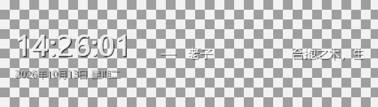
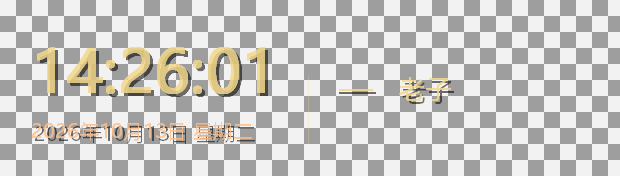
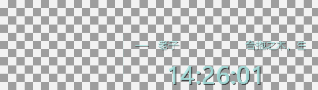
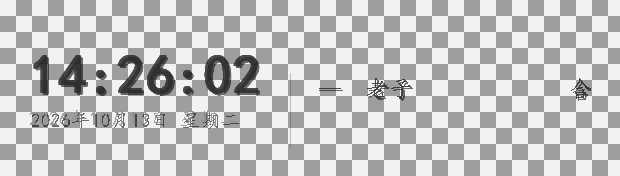
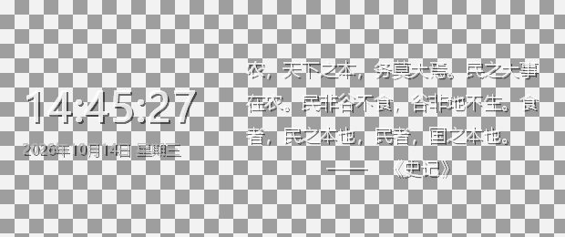
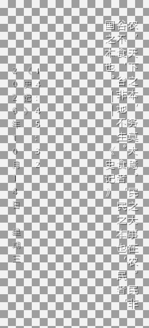
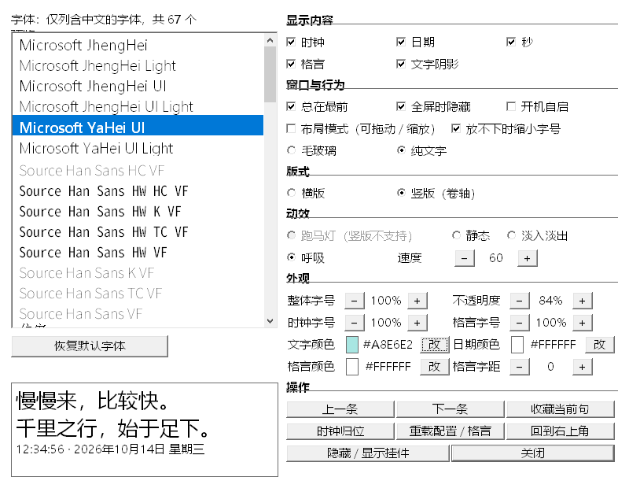

# desk-geyan · 桌面格言挂件

Rust + 纯 Win32（`windows-sys`，无 GUI 框架）实现的桌面格言 / 时钟挂件。
毛玻璃底板 + **逐像素 alpha** 的文字层，跑马灯动效，鼠标穿透、永不抢焦点，
所以它挂在桌面上不会影响任何其他操作。

时间 / 日期 / 格言每块都能单独开关；字体、字号（整体 + 分块）、颜色（主色 + 日期色）
全部可配；时间日期块在布局模式下可以直接拖着挪位置。

**所有配置项都收在同一个设置面板里**：托盘右键菜单的「设置…（字体 / 显示 / 外观 / 版式 / 动效）」
（或 `Ctrl+Alt+O`）打开一个**普通、可点击的窗口** —— 左边从系统字体列表挑字体（**只列真的含汉字
的字体**，每行用它自己的字形渲染），右边是全部开关 / 单选 / 数值 / 配色，改哪一项都**立即生效**，
不用重启。

```
┌──────────────────────────────────────────────────────┐
│                                                      │
│   11:50:30        ┊   慢慢来，比较快。——               │
│   2026年10月13日 星期二            千里之行，始于足下。 │
│                                                      │
└──────────────────────────────────────────────────────┘
```

---

## 效果预览

下面都是 `--dump` 按不同配置导出的**实际渲染结果**，尺寸与窗口 1:1。
（**棋盘格是衬底**，只是为了把透明区域显出来，不是挂件画上去的。）

| 默认外观 | 暖色调 · 字号 130% |
| :---: | :---: |
|  |  |

| 时间日期块移位 | 深色 · 换字体 |
| :---: | :---: |
|  |  |

| 长句折行（D1 修复）· 620×260 | 竖版卷轴式 · 300×660 |
| :---: | :---: |
|  |  |

> 左图是 55 字长句在 620×260 里的实际结果：折成 3 行、**连出处完整可见**。
> 旧实现在这里只会画一行，后半句和出处**静默消失**（连省略号都没有）。
> 右图是竖版：主文竖排**列自右向左**，左侧三列落款自右向左为
> 时间（主色）→ 出处 → 日期；中列那根竖线是 `——` 旋转 90° 后的样子。

---

## 快速开始

```bash
cargo run --release
```

首次运行会把自己贴在**工作区右上角**，位置/尺寸/透明度等都会记住
（存在 `%APPDATA%\DeskGeyan\config.ini`）。

想改点什么？托盘右键 →「设置…（字体 / 显示 / 外观 / 版式 / 动效）」，或按 `Ctrl+Alt+O`，
开**设置面板**：左边换字体（每行用它自己的字形渲染），右边改所有开关与配色，
选中/点下**立即生效**，不用重启。

自检与行为探测（都不常驻，跑完即退，且都**零副作用** —— 会先把配置快照起来再原样写回）：

```bash
cargo run --release -- --selftest   # 渲染管线 + 动效状态机 + 各可配置项的断言
cargo run --release -- --probe      # 读回窗口样式与可见性，验证「不干扰桌面」三道闸
cargo run --release -- --clicktest  # 鼠标穿透的**行为**实测（真实光标，不读样式位）
cargo run --release -- --favtest    # 收藏当前句子：**真的按一次 Ctrl+Alt+F**，验剪贴板/收藏夹/幂等
cargo run --release -- --dragtest   # 把「按下→移动→松开」灌进真窗口过程，验证拖动链路
cargo run --release -- --perf       # 各档拖动的吞吐上限（µs/条）+ 空转出帧数
cargo run --release -- --dragbench  # 跟手标定：窗口移动的成本拆解 + 真实节奏 + 途中滞后
cargo run --release -- --memtest    # 内存/资源 soak：120 轮，判 Private Bytes 与 GDI/USER/句柄
cargo run --release -- --quotes     # 把格言库真加载一遍：查 BOM / 注释漏入 / 分隔符残留 / 重复
cargo run --release -- --autostart on|off|query   # 开机自启的查询 / 设置（托盘菜单同一开关）
```

`--dragtest` 走 `PostMessage` 而不是注入系统级鼠标：不会打扰你当前的鼠标操作，
而且一次拖动成为自包含的事件序列，可复现。它验证的正是手感相关的那几条 ——
非布局模式不误触、位移量与光标一致、松开后不吞桌面鼠标、拖出边界被夹住、
以及**夹取后往回拖立即跟手**（不会出现「光标动内容不动」的空走）。

想直接看渲染结果（不用盯着跑马灯等它滚过来）：

```bash
# 当前配置的一帧 → PNG（透明区域用棋盘格衬底，抗锯齿边缘看得清）
cargo run --release -- --dump shots/a.png

# 临时试一套外观：key=value 与配置文件同源，随便覆盖
cargo run --release -- --dump shots/b.png color=#F5D98B scale=130 clock_dx=260 show_date=false

# 竖版卷轴式（主文竖排 + 左侧落款），顺带试试字距与格言独立配色
cargo run --release -- --dump shots/c.png orient=vertical letter_spacing=4 quote_color=#F5D98B
```

`shots/` 里放了几张用这条命令导出的样例，可以直接看效果（棋盘格是衬底，不是挂件画的）。

---

## 快捷键（全是全局热键）

因为窗口鼠标穿透，所有操作都走热键和托盘菜单。默认修饰键是 `Ctrl+Alt`。

| 快捷键 | 作用 |
| --- | --- |
| `Ctrl+Alt+H` | 显示 / 隐藏 |
| `Ctrl+Alt+C` | 显示 / 隐藏 **时间** |
| `Ctrl+Alt+D` | 显示 / 隐藏 **日期** |
| `Ctrl+Alt+K` | 循环切换**文字颜色** |
| `Ctrl+Alt+O` | 打开**设置面板**（字体 / 显示内容 / 窗口行为 / 版式 / 动效 / 外观，见下文） |
| `Ctrl+Alt+=` / `-` | **整体字号** + / −（12 档） |
| `Ctrl+Alt+M` | 切换动效（跑马灯 → 静态 → 淡入淡出 → 呼吸） |
| `Ctrl+Alt+T` | 切换 **毛玻璃 / 纯文字** 模式 |
| `Ctrl+Alt+E` | **布局模式**（临时放行鼠标：拖空白处移动、拖时间挪时间、四边缩放） |
| `Ctrl+Alt+↑` / `↓` | 调高 / 调低不透明度 |
| `Ctrl+Alt+←` / `→` | 上一条 / 下一条格言 |
| `Ctrl+Alt+F` | **收藏当前句子**（复制到剪贴板 + 加入轮播） |
| `Ctrl+Alt+P` | 总在最前 开 / 关 |
| `Ctrl+Alt+R` | 重新载入格言与配置 |
| `Ctrl+Alt+S` | 隐藏（到托盘） |
| `Ctrl+Alt+X` | 退出 |

**托盘菜单只留高频操作，全部设置集中在设置面板**（不重复列）：

| 菜单 | 内容 |
| --- | --- |
| **设置…** | 打开**设置面板**：字体 / 显示内容 / 窗口行为 / 版式 / 动效 / 外观，全在这一页里 —— 配置的**唯一入口** |
| 显示 / 隐藏 | 同 `Ctrl+Alt+H` |
| 格言操作 | 上一条 / 下一条 / 收藏当前句子（同三个热键） |
| 维护 | 重新载入格言 / 配置、挂件回到右上角、重置时间日期位置 |
| 退出 | — |

> 布局模式是唯一能碰到窗口的时候：面板会显形并画上边框，
> **时间日期块还会额外框出一个框**，拖它就能把时间挪到任意位置（拖出边界会自动夹住）；
> 拖框外的空白处移动整个挂件，拖四边缩放。`Ctrl+Alt+E` 退出后立刻恢复穿透。

---

## 设置面板

挂件本体是鼠标穿透的（点不到），托盘菜单一项一项点又太碎。所以把所有配置项收进**同一页**：
托盘右键的「设置…（字体 / 显示 / 外观 / 版式 / 动效）」，或 `Ctrl+Alt+O`，会打开一个
**普通、可点击的**顶层窗口（会出现在任务栏里）。**菜单里不重复列任何设置项** ——
改配置只有这一个入口，两处状态各画一份的维护税不存在。



窗口 800×620，左右两栏：

- **左栏**：字体列表 + 预览区 + 「恢复默认字体」。
- **右栏**：**全部配置项**，按六组排 ——
  **显示内容**（时钟 / 日期 / 秒 / 格言 / 文字阴影）、
  **窗口与行为**（总在最前 / 全屏时隐藏 / 开机自启 / 布局模式 / 放不下时缩字号 / 毛玻璃 / 纯文字）、
  **版式**（横版 / 竖版卷轴式）、
  **动效**（跑马灯 / 静态 / 淡入淡出 / 呼吸 / 速度）、
  **外观**（整体字号 / 不透明度 / 时钟字号 / 格言字号 / 文字颜色 / 日期颜色 / 格言颜色 / 格言字距）、
  **操作**（上一条 / 下一条 / 收藏当前句 / 时钟归位 / 重载配置 / 回到右上角 / 隐藏·显示挂件 / 关闭）。

一共 **68 个控件**，其中 **40 条**会真的改到配置或执行动作。三条设计决定：

- **只列「真的含汉字」的字体。** 挂件画的是中文格言和「2026年10月14日 星期三」，一个只有
  拉丁字形的字体选上去只会让整块内容变成豆腐块（`□□□`）而不报错。判据不靠字体名猜 ——
  用 `GetGlyphIndicesW` 逐字查字形索引，配 `GGI_MARK_NONEXISTING_GLYPHS` 时「没有的字形」
  返回 `0xFFFF`，于是「有没有」变成一次可判定的比较。本机 238 个家族里过滤出 **67 个**
  含汉字的。
- **每行用该字体自己的字形渲染**（owner-draw, `LBS_OWNERDRAWFIXED` + `WM_DRAWITEM`）。
  光看「SimSun」这几个字母，分不出宋体长什么样 —— 这是字体选择器唯一真正有用的形态。
  选中即落盘 + 重绘挂件，**不需要「确定」按钮**（和菜单里每一项的行为一致）。
- **所有改动走同一条写入路径。** 面板上任何一个控件都**不直接改 `cfg`**：它只调
  `app::on_menu(a, MI_xxx)` 发一条命令 —— 和托盘菜单**完完全全同一条路**。这样「面板改的」
  和「菜单改的」不可能有两种行为（不会有一处忘了 `cfg.save()`、一处忘了重绘）。反过来，
  控件的勾选 / 文字 / 可用状态每次都从 `cfg` **重新读**回来（`refresh_widgets`），
  从不缓存在控件里 —— 于是「界面显示的」和「配置里的」不一致这件事是**可以被断言抓到**的。

布局是**表格驱动**的：一张 `table()` 就是全部控件的规格（角色 / 占几格 / 文案 / 命令码），
`slots()` 按 6 个单位列排布、排不下自动换行、遇到「章节标题」强制起新行。加一个配置项
= 在表里加一行，建窗、状态同步、断言清单全都自动跟上。

> **@ 开头的竖排别名（`@宋体` / `@微软雅黑`…）不进列表**：它们只是同一套字形的旋转包装，
> 普通横排选择里列出来纯属噪声；竖版形态由排版层自己处理。

资源方面：列表里每个字体名都是一个独立的 `HFONT`，窗口销毁时逐个 `DeleteObject`。

`--probe` 里有七条断言盯着这个面板：

| 断言 | 判据 |
| --- | --- |
| 设置面板·控件与表格一一对应 | 建出来的 40 个可点控件，命令码与 `table()` **逐个相同** |
| 设置面板·建好后显示与配置一致 | 每个控件的勾选状态 / 文字 / 可用性都从 `cfg` 重读，**零处不一致** |
| 设置面板·每个控件都改得动、显示跟得上 | 逐个点一遍：点完 `cfg` 必须变，再点配对命令（`+`/`−`、开关）必须**回到原值**、显示也跟着回（纯动作项另计） |
| 设置面板·换色后色块真的重画 | 抓色块中心像素：点一下必须**变色**，绕一整圈预设回来必须**变回同色** |
| 设置面板·预览样例不超出预览框 | 三行样例在当前字体下都装得下（改回长句立刻红：382px > 可用 328px） |
| 设置面板：建窗 + 字体列表 + 开关两轮不涨句柄 | 开→关→开→关两轮，GDI 对象数必须**持平**（首轮那点一次性增量是 uxtheme/comctl32 的进程级缓存，不随开关累积） |
| 设置面板·连续换字体后预览区不叠字 | 「直接设成字体 A」与「A→B→C→A 绕一圈」两次 `PrintWindow` 抓的预览区**逐像素相同**（0 px 不同）—— 见「踩过的坑」第 15 条 |

另有一条在 `--selftest`：「设置面板·控件清单（表格即规格）」把 40 条命令的**完整清单**写死在
断言里 —— 漏一个、重一个、两个控件发同一条命令（看起来都能点、其实有一个在改另一个的字段），
它都会红；顺带断言「最小窗口下底部还有 19px 余量、任意两个控件矩形不交叠」—— 面板没有滚动条，
**排不下就是看不见**，所以这条不能靠看截图。
同一份 `--selftest` 里还有一条「设置面板·字体列表（只列含汉字的字体）」：直接断言过滤后的
列表确实**全部含汉字**、且不含 `@` 竖排条目。

---

## 配置

`%APPDATA%\DeskGeyan\config.ini`，改完用 `Ctrl+Alt+R` 或托盘菜单重载。

| 键 | 含义 | 默认 |
| --- | --- | --- |
| `x` `y` `w` `h` | 位置与尺寸（物理像素） | 右上角 / 620×176 |
| `opacity` | 整体不透明度 `30-255` | `215` |
| `mode` | `glass`（毛玻璃）/ `text`（纯文字） | `glass` |
| `anim` | `marquee` / `static` / `fade` / `breathe` | `marquee` |
| `always_on_top` | 总在最前 | `true` |
| `show_clock` `show_date` `show_quote` | 三块内容的开关 | `true` |
| `seconds` | 时钟是否显示秒（窗口窄时自动降级为 `HH:mm`） | `true` |
| `shadow` | 文字阴影（浅色壁纸下把字托起来） | `true` |
| `speed` | 跑马灯速度 `px/s`，`10-400` | `60` |
| `scale` | **整体**字号百分比，`30-600` | `100` |
| `clock_scale` | 时钟（含日期）相对整体字号的倍率，`30-600` | `100` |
| `quote_scale` | 格言相对整体字号的倍率，`30-600` | `100` |
| `font` | 字体名（`Microsoft YaHei UI` / `SimSun` / `KaiTi` / `Consolas` …） | `Microsoft YaHei UI` |
| `color` | **主色**（时钟 + 格言），`#RRGGBB` 或 `RRGGBB` | `#FFFFFF` |
| `date_color` | **日期颜色**，可与主色不同 | `#B8B8B8` |
| `clock_dx` `clock_dy` | 时间日期块相对默认位置的像素偏移（布局模式下直接拖即可） | `0` `0` |
| `visible` | 启动时是否显示 | `true` |
| `auto_hide_fs` | 全屏应用（游戏 / 全屏播放）运行时自动隐藏 | `true` |
| `orient` | 版式：`horizontal`（横版）/ `vertical`（**竖版卷轴式**） | `horizontal` |
| `letter_spacing` | 格言字距 `0-8`（相对值，按整体字号缩放） | `0` |
| `quote_color` | 格言专用色，可与主色不同；`unset` = 跟随主色 | `unset` |
| `shrink_fit` | 放不下时允许「缩字号」回退（100% → 85% → 70%） | `true` |
| `h_w` `h_h` `v_w` `v_h` | 两种版式各自的窗口尺寸记忆（切版式时自动带上，不用手改） | 620×176 / 300×660 |

> **竖版卷轴式（`orient=vertical`）**：主文竖排、**列自右向左**（条幅的读法），
> 左侧一列列小字是落款 —— 自右向左为**时间**（主色）→ **出处** → **日期**（日期色）。
> 竖排的句读点号（`，。、；：`）会挪到本格的**右上角**，`——` / `……` 旋转 90°。
> 竖版下**跑马灯自动降级为静态**（横向滚动的文字配竖排字格是横竖混排的怪物）；
> `eff_anim()` 是「生效动效」的唯一出口，`step` / `needs_frame` / 绘制 / 菜单四处都读它。
> 切版式走托盘菜单「版式」，窗口尺寸会自动换成该版式上次用的那一套。

> **换句动效**（`static` / `fade` / `breathe` 下换句时）：顺序相位
> 「旧句淡出 160ms → 空 140ms → 新句淡入 260ms + 微位移」，**只作用于格言**
> （时钟/日期/底板逐位不动），停留 4~10s（按字数）。`marquee` 是连续传送带、
> 没有换句点，不播过渡。详见「换句动效」节。

> **开机自启不走配置文件** —— 它写在 `HKCU\...\Run` 注册表里，那是唯一状态源
> （用户在 msconfig / 管家软件里改了启动项，配置文件不会知道）。
> 三条规矩：只删自己那条值；写入前先读回原值、别人的项先备份到
> `DeskGeyan_prev`；关闭时原样恢复备份。`--probe` 会查「有没有指向
> 已不存在 exe 的陈旧项」。

> 字号是「整体 × 局部」两个旋钮：`scale` 把时钟/日期/格言一起放大，
> `clock_scale` / `quote_scale` 再各自微调 —— 想要「时间很大、格言小一点」
> 就设 `scale=130 clock_scale=150 quote_scale=80`。
>
> 颜色改的是**字形本身**，不是叠一层色块：掩码层永远用白字黑底采覆盖率，
> 颜色在最后预乘时才乘进去（详见下文），所以换色不影响抗锯齿质量。
> 浅色壁纸建议 `color=#2B2B2B`，深色壁纸用白或暖黄 `#F5D98B`。

### 自定义格言

在 `%APPDATA%\DeskGeyan\quotes.txt` 里一行一条，格式 `正文 —— 作者`
（作者可省略；`--`、`——`、制表符都能当分隔符；`#` 或 `;` 开头是注释）。
文件里的条目会**排在**内置 72 条之前优先显示，改完按 `Ctrl+Alt+R` 重载。

**多文件分组**：也可以建一个 `%APPDATA%\DeskGeyan\quotes\` 目录，
里面每个 `.txt` 是**一组**（`quotes.txt` 本身算第一组）。组内按行序，
组间**轮流**出现：

```
quotes.txt            甲一 甲二
quotes/01_乡村振兴.txt   乙一 乙二 乙三
quotes/02_古诗.txt       丙一
→ 播放序：甲一 乙一 丙一 甲二 乙二 乙三
```

为什么不是「一组播完再播下一组」：组大小往往差一个量级（申论 152 条 vs
古诗 30 条），顺序播放会让小组几分钟才露一次面。round-robin 让每个文件
按自己的行序均匀出现，而「放到最前的组最先出现」这个老语义也保得住
（第一轮就是按组序）。想控制组序就用 `01_` `02_` 这种前导零命名。
只有一个文件时行为与旧版**逐字节一致**。

**收藏夹**：看到喜欢的句子，按 `Ctrl+Alt+F`（或托盘菜单「收藏当前句子」）
—— 它会**同时**做两件事：把当前这句复制到剪贴板，并追加到
`quotes\favorites.txt`。于是收藏夹自动成为上面分组机制里的**一组**，
和你的分区文件按 round-robin 轮流出现，不需要任何额外操作。

三个设计决定：

- **写独立文件，不追加进你的 `quotes.txt`。** 你的源文件往往按主题精心分区，
  程序往里追一行等于把排版搅乱；而且你手工编辑时会看到一行不知道什么时候
  冒出来的东西。独立文件还让「清空收藏」变成删一个文件的事。
- **只在收藏夹内查重。** 收藏的语义是「这句话进我的收藏组」，不是
  「这句话全世界唯一」。收藏一句内置格言，就是想让它和古诗、申论一起
  轮流出现（效果正是「更常出现」）。反过来若按全库查重，点一句内置格言
  会被告知「已在库中」而什么都没发生。
- **两件事互不牵连。** 剪贴板可能被别的窗口占着（`OpenClipboard` 会失败，
  各种管家软件、剪贴板历史程序都在盯着这块，所以内置了重试）—— 那是
  「复制没成」，不该连累「收藏没成」。任一半失败，另一半照做，
  托盘气泡里如实说。

收藏对**当前画面完全无感**：不重置滚动位置、不换句，只是这句从此进了
轮播候选（`--favtest` 对这条下断言：收藏后 `qi` 必须仍指着同一句，
否则用户看到的就是「点了收藏，画面自己跳了」）。

改完跑一次 `--quotes` 确认解析正确 —— 「文件写进去了」和「程序读出来了」
中间隔着一个解析器，最容易静默出错的三处它都会查：

| 断言 | 防的是什么 |
| --- | --- |
| 分组加载 | 报出「几组 · 各组几条」—— 多文件用法下最想知道的就是这个 |
| 无 BOM 污染 | 用记事本「另存为 UTF-8」会加 `EF BB BF`，那个 U+FEFF 黏在第一行行首，**本该跳过的注释行会变成一条格言**（`#` 前面多了个字符，躲过了 `starts_with('#')`）。现在读取时自动剥离。 |
| 注释未被当成格言 | 上面那条的兜底：分区注释若漏进库，第一条必然以 `#` 开头。 |
| 分隔符已切净 | `正文 —— 出处` 被切开后，两边都不该再残留 `——`；残留说明行里出现了第二个分隔符。 |
| 不与内置库撞车 | 同句在外部和内置各有一份时，外部那份会把内置的盖住，白占一个位置。 |
| 每条都有正文 / 出处 | 空行、跨行写法导致的截断。 |

**素材库**：`assets/quotes-shenlun.txt` 是一份 152 条的申论写作素材
（按乡村振兴 / 基层治理 / 为民 / 实干 / 改革 / 法治 / 修身 / 廉洁 / 诚信 / 生态 /
文化 / 家国 / 青年 / 方法 / 团结 十五类整理，逐条标出处）。**轮播顺序就是文件行序**，
所以最想常看的两类放在了最前面。
配套的 `docs/申论写作素材.md` 是同一批素材的可检索版，多了「用在哪」一列。
用的时候把 `assets/quotes-shenlun.txt` 复制到 `%APPDATA%\DeskGeyan\quotes.txt` 即可。

---

## 实现要点

### 为什么文字能「贴」在桌面上，而不是浮一个黑框

关键在于**不能用** `LWA_COLORKEY` / 全局 alpha 这类 8bpp 思路 —— 它们会让
字形边缘变成硬边，效果就是一块带黑框的贴片。真正的做法是让每个像素各自
带 alpha，也就是 `UpdateLayeredWindow` + `AC_SRC_ALPHA`。

管线（`src/gfx.rs`）：

```
① 离屏 32bpp DIB 涂黑 → GDI 在白字上绘制（灰度抗锯齿）
     → 每个像素 RGB 都等于字形覆盖率 c
② 掩码：alpha = R（白字黑底时 R 就是覆盖率，与颜色无关）
③ 预乘：颜色在这里才乘进来  c = color · alpha / 255
     → 一个乘加就够，无需浮点
④ UpdateLayeredWindow 上屏，DWM 按像素 alpha 合成
```

一帧要跑**三趟** GDI 绘制，得到三条独立的掩码通道：

| 通道 | 画什么 | 怎么画 | 谁贡献颜色 |
| --- | --- | --- | --- |
| `mask` | 时钟 + 分隔线 + 格言 | 黑底**白**字 | `color` |
| `dmask` | 日期 | 黑底**白**字 | `date_color` |
| `shad` | 全部内容 | 白底**黑**字 | 只贡献 alpha（恒为黑） |

拆三条通道正是「颜色可配置」的代价与红利：同一条通道只能有一个颜色，而时钟
和日期天生就该是两个颜色（主次分明），多画一遍在 620×176 上可以忽略不计。

阴影走**白底黑字**，`alpha = 255 - R`。它的预乘颜色恒为 `(0,0,0)`，所以合成
时只贡献 alpha、不污染颜色 —— 浅色壁纸上白字依然立得住。合成的数学约束是
`颜色分量 ≤ alpha`；因为 `color ≤ 255`，`c = color·alpha/255 ≤ alpha` 恒成立，
**不需要任何夹紧**。`--selftest` 会逐像素验算这一点。

两个必须守住的反直觉细节：
* 字体质量只能用 `ANTIALIASED_QUALITY`。`CLEARTYPE_QUALITY` 是次像素渲染，
  字缘会带红蓝边，进掩码就是脏边。
* 跑马灯必须 `IntersectClipRect` 裁剪，否则字形会盖到时钟上。

### 为什么是两个窗口

毛玻璃和「文字贴合」在同一个窗口里是互相打架的：

* DWM 的 Acrylic 只能作用在**没被 GDI 画过**的像素上。跑马灯每 40ms 就要
  整块重画一次，一旦画过，毛玻璃就被自己糊住了。
* 反过来，底板窗口要是老实不画，文字又没地方放。

所以拆成 `下层毛玻璃底板 + 上层逐像素 alpha 文字`：

| | 样式 | 职责 |
| --- | --- | --- |
| 底板 `DeskGeyanPanel` | Acrylic accent，**从不绘制** | 只让 DWM 画它，永不污染 |
| 文字 `DeskGeyanText` | `WS_EX_LAYERED` + ULW，**恒穿透** | 每帧整块重画 |

纯文字模式 = 藏起底板，剩下就是只有字形贴在桌面上。
布局模式 = 把底板显出来当拖拽把手。

### 时间日期为什么能单独拖，且拖不丢

命中判定在 `WM_NCHITTEST` 里：落在时间日期块的矩形上就返回 `HTCLIENT`
（让鼠标消息落到自己手里），否则沿用原来的「中间拖动 / 四边缩放」。

位置 = **默认位置**（左侧垂直居中）+ 拖动偏移，最后**夹进窗口内**。
夹取时回写的是**夹取后的实际偏移**，而不是夹显示位置 —— 否则拖出边界
200px 再往回拖，前 200px 光标动了内容不动，就是那种「粘住」的手感。

块的矩形是渲染时量出来的（`clock_rect` 缓存在 `App` 上），因为 wndproc 里
没有 DC 去量文字宽度。字体、字号、窗口尺寸一变就重新夹一次。

### 多显示器：按「挂件所在屏」取基准，不是主屏

以前所有位置计算都走 `SystemParametersInfoW(SPI_GETWORKAREA)` —— 它返回的是**主屏**
工作区。单屏上完全正确，接上副屏之后整个基准就是错的：

* 挂件拖到副屏后，`clamp_keep_visible` 仍按主屏夹取，副屏上的窗口会被夹到主屏的
  坐标范围内，视觉上就是**「窗口自己跳走了」**；
* 任务栏在副屏时，副屏的可用高度被主屏的值顶替，落位与缩放夹取全错；
* 副屏 DPI 与主屏不同时，前面做的 `PER_MONITOR_AWARE_V2` 等于白做 ——
  DPI 感知是对的，但「按哪块屏」错了。

现在改成按挂件当前位置取所在显示器：

```rust
let hmon = MonitorFromPoint(POINT { x: x + w / 2, y: y + 8 }, MONITOR_DEFAULTTONEAREST);
let mut mi: MONITORINFO = zeroed();
mi.cbSize = size_of::<MONITORINFO>() as u32;
GetMonitorInfoW(hmon, &mut mi);   // mi.rcWork = 这块屏的工作区
```

`MONITOR_DEFAULTTONEAREST` 而不是 `MONITOR_DEFAULTTOPRIMARY`：挂件被拖到所有屏幕之外时，
「最近的显示器」才是该把它夹回去的那块，「主显示器」不是。取不到显示器信息时退回
`SPI_GETWORKAREA`（老系统 / 异常路径）。

`--probe` 有一条断言守这件事：

| 断言 | 判据 |
| --- | --- |
| 多显示器：夹取基准 = 挂件所在屏 | `work_area_at(...)` 返回的 `rcWork`/`rcMonitor` 与直接从 `MonitorFromPoint` 读回的**逐字段相同**（`windows-sys` 的 `RECT` 没 derive `PartialEq`，且副屏工作区可能与主屏等宽等高却整体偏移，所以按面积或宽高比相等都不算） |

> **这条断言在单屏机上恒真** —— 挂件只在主屏上时，按位置取的屏就是主屏，与旧行为完全一致。
> 它证明的是「新代码路径活着且自洽」，真正会红的场景是接上副屏之后。
> 单屏机器上无法区分「正确实现」和「永远返回主屏」的实现，这是测试的固有局限，如实记下。

### 拖动为什么跟手

拖起来「粘手」有两层成因，第一层好懂，第二层是这次才挖出来的。

**第一层：画得没必要。** 旧的 `WM_MOUSEMOVE` / `WM_MOVE` 每条消息都跑一遍完整帧 ——
重建三条掩码通道、预乘、`UpdateLayeredWindow`。而**位置变化不影响任何一个像素**：
掩码、合成、预乘结果都和窗口在哪无关。这一帧对「窗口挪了 1px」零贡献，却要花 ~800µs。

**第二层：位置落定本身也有成本。** 把重绘摘掉之后，每条消息仍要「底板 `SetWindowPos`
+ 文字层上屏」，这一笔实测 ~340µs。单看够用，但它跟任何一次偶发重绘叠在一起就超预算。

预算是死的：1000Hz 鼠标每 1ms 一条消息，即每条消息只有 **1000µs**。
旧做法一条消息吃掉 1290µs，消息队列必然越积越长 —— 手感就是「越拖越落后」。

改动汇总：

| 措施 | 做法 |
| --- | --- |
| **只挪不画** | 移动路径只做「底板 `SetWindowPos` + 文字层 `UpdateLayeredWindow`」，零重绘 |
| **状态与画面解耦** | 状态每条消息即时更新（µs 级，绝不积压）；画面走 `dirty` + `DRAG_FRAME_MS = 8` 节流，松手 `force` 一帧停在最终状态 |
| **位置也节流** | 窗口位置走 `DRAG_MOVE_MS = 8`，`last_move` 记录上次落定时间 |
| **停手补最后一格** | 拖动期间把定时器收紧到 `DRAG_TICK_MS = 8`。位置落定是「有请求才检查」，用户停手后没有后续请求，欠着的那一格只能靠定时器补 |
| **空转不出帧** | `needs_frame()` 按时钟刻度（秒/分）与动效类型判断这一拍会不会变；`tick` 不再无条件补帧 |

最后一条是被漏掉的一环：定时器 25Hz，`tick` 原来在 `step()` 之后**无条件**再补一次
`render_and_present()`，把 `needs_frame` 整个绕过去了 —— 静态挂着一个不动的挂件，
每秒也白烧 25 × 830µs ≈ 2% 的 CPU，而且这批重绘正好在拖动时跟鼠标消息抢时间片。

**位置节流带来一个必须配套的前提**：`cfg.x/y` 从此表示「**目标**位置」，不再等于窗口
真实位置。所以任何要把「客户区坐标」还原成「屏幕坐标」的地方，都必须读窗口**真实位置**
（`win_rect`），不能拿 `cfg` 顶替 —— 否则窗口落后期间会把已经欠着的位移重复计入，
误差按三角数放大，表现就是**鼠标一动、窗口乱飘**（详见「踩过的坑」第 6 条）。

代价是每条移动消息多一次 `GetWindowRect`（约 50µs，把 ULW 与 SWP 的差距从 2× 稀释到 6%）。
**这个钱值得花**：本轮 bug 的根因恰恰是「用一个记账值代替窗口真实位置」，
再引入一个新的记账字段去省 50µs 是同一个方向的赌注。174µs « 1000µs 预算，
这里要的是「不一致会发生」，不是「再快一点」。

#### 成本模型（`--dragbench`）

移动窗口有多贵不能靠猜。`--dragbench` 用离屏窗口直调 API，每种 400 次平均（前面先跑
100 次**丢掉**当预热 —— 第一档永远是最先跑的，不预热它的读数会系统性偏高，而它恰好是
「关掉 Acrylic 值不值」这个结论的第一手数据），**并且每档都读回窗口真实位移**：
只报耗时不报位移，会把「走了完整流程但什么也没动」也算成一次成功移动（这个坑真踩过：
早期版本七档里五档显示「移动 0 px」，因为每档都停在同一个终点坐标上）。

| 单次移动成本 | µs（每档 400 次平均，前 100 次丢弃当预热） | 位移 |
| --- | --- | --- |
| 只挪底板（Acrylic 显形） | 214 | 399 px |
| 只挪底板（关掉 Acrylic） | 216 | 399 px |
| 只挪底板（窗口隐藏） | 103 | 399 px |
| 只挪文字层（`SetWindowPos`） | 155 | 399 px |
| 只挪文字层（`UpdateLayeredWindow`） | 71 | 399 px |
| 两个窗口都用 `SetWindowPos` | 377 | 399 px |
| 底板 `SetWindowPos` + 文字层 `ULW`（= 现在默认） | 335 | 399 px |

这张表读出三条结论，其中两条和最初的直觉相反：

1. **钱不在模糊，在「合成一个可见窗口」本身。** 关掉 Acrylic 只差约 ±10µs（≈0%），
   几乎不省；只有整窗隐藏才省下 ~130µs。所以「布局模式关掉毛玻璃提速」是伪优化 ——
   为它改代码只增加风险。（**没有预热时这一档会飘到 −15%**，差点让我把伪优化当成真的。）
2. **文字层用 `UpdateLayeredWindow` 挪比 `SetWindowPos` 快一倍**（~85 vs ~192µs）：
   分层窗口的位置变更走 ULW 是专线，`SetWindowPos` 要跑整套窗口变更流程
   （`WM_WINDOWPOSCHANGING` → `WM_NCCALCSIZE` → `WM_WINDOWPOSCHANGED`）。
3. 两条路径混用（底板 SWP + 文字 ULW）比都用 SWP 省 ~78µs（17%）。

真实节奏（每条消息间等 1000µs，模拟 1000Hz 连续甩鼠标）：

| 配置 | µs/条 | 松手位移 | 途中滞后 |
| --- | --- | --- | --- |
| 节流关（成本上限） | 450 | 800/800 | 峰 0 |
| 节流 8ms · `SetWindowPos` | 145 | 800/800 | 峰 8 / 均 3.5 px |
| 节流 8ms · `UpdateLayeredWindow`（现在默认） | **132** | 800/800 | 峰 8 / 均 3.5 px |

> 这一节的轨迹构造是**分模式的**：`paced` 档每条之间等 1000µs、消息随到随处理，
> 所以能按**处理时的窗口位置**回算客户区坐标（真实轨迹）；`flood` 档的坐标必须在
> 发送前全部算好，只能用「光标相对窗口恒定」那条**关节流才成立**的轨迹。
> 早先两种都灌恒定坐标，其中一处恰好掩盖了一个严重的累积误差 bug —— 见「踩过的坑」第 6 条。

判据三条全过：

- **松手位移一条不丢**（800/800）—— 节流绝不吞掉最终位置。
- **真实节奏下单条 132µs < 预算 1000µs**，余量 7.6×；节流把 450µs 压到 132µs 是 **3.4× 提速**。
- **途中滞后峰值 8px = 恰好一个节拍**。这是节流的定义性代价，不是丢帧：
  光标每 1ms 走 1px，窗口每 8ms 落一次，任何时刻最多欠 8px。

一条鼠标移动引发的消息（节流 8ms，照 800 条移动消息计）：`WM_MOUSEMOVE` 800 条 →
`WM_MOVE` 100 + `WM_WINDOWPOSCHANGED` 100 + 其它 100，共 1100 条。
（`WM_NCHITTEST` 被 `DefWindowProcW` 消化掉，不产生额外消息。）

`--perf` 看的是同一个问题的另一面 —— 各档的**吞吐上限**（每项 200 次平均，µs/条）。
注意这一档是**节流关**口径，即「每条消息都真的落一次窗口」，是成本上限不是真实节奏：

| 场景 | 现在 | 旧做法 |
| --- | --- | --- |
| 整体移动 | **336** · 2975 条/秒 | 1467 · 682 条/秒（会积压） |
| 拖时间日期块 | **25** · 39628 条/秒 | 同级开销 + 每条一次整帧重绘 |
| 缩放窗口 | **976** · 1025 条/秒 | 同级开销 + 每条一次整帧重绘 |
| 只挪底板（1× `SetWindowPos`） | 220 | — |
| 一条 `WM_MOVE`（只同步几何） | 2 | — |

> 缩放这一档贴着 1000µs 预算（976µs，所以 `--perf` 的收尾提示时红时绿）。
> 它比成本拆解里「两个窗口都用 `SetWindowPos`」的 377µs 高出一倍，多出来的是
> **帧缓冲随尺寸重建**（重绘本身 ~849µs，按 8ms 节拍摊销）。真实使用时 `DRAG_MOVE_MS`
> 节流是开着的，位置不会每条都落，所以实际不会积压 —— 留作已知项。


#### `--dragtest` 守着什么

- **41 条鼠标消息 → 0 次整帧重绘**：用 `PrintWindow` + `PW_RENDERFULLCONTENT` 把分层窗口的
  DWM 合成结果真读回来，逐像素比对「挪完之后画面和挪之前一模一样」（0 px 不同 / 109120 px）。
- **节流不吞输入**：灌 12 条消息，拖动中只走 0px（被节流欠着），**松手后 12/12 px 且落盘一致**。
- 其余端到端：非布局模式不误触、位移量与光标一致、松开后不吞桌面鼠标、
  拖出边界夹住且**回拖立即跟手**（不会空走）、松手即出最终帧（不留 `dirty` 等下个节拍）。

### 内存：不涨才算合格（`--memtest`）

要求是「运行不能内存泄漏，占用也不能扩大」。泄漏和「占用大」是两件事，
判据也要分开 —— 前者看**精确计数**，后者看**长期趋势**：

| 指标 | 起始 | 结束 | 判据 | 结论 |
| --- | --- | --- | --- | --- |
| Private Bytes | 4.0 MB | 3.1 MB | 前 1/3 轮 vs 后 1/3 轮，容差 2 MB | **稳定**（峰波动 0.0 KB） |
| GDI 对象 | 19 | 19 | 精确持平 | 持平 |
| USER 对象 | 13 | 12 | 精确持平 | 持平 |
| 内核句柄 | 195 | 195 | 精确持平 | 持平 |
| Working Set | 16.8 MB | 44.8 MB | **不判定**，仅报数 | 见下 |

测试是 120 轮 soak + 5 轮预热，每轮做：3 次拖动（整窗 / 时间日期块 / 缩放）+
换字号 + 换色 + 换动效 + 换模式。Private Bytes 均值前 3.3 MB → 后 3.3 MB（**Δ −0.0 MB**）。

三点说明：

- **为什么 GDI / USER / 句柄要求「一点不涨」**：这三类是内核里的**有限资源**，
  GDI 对象默认每进程上限 10000，泄漏会先撞配额再崩。它们没有「可回收」一说，
  涨了就是漏了。Private Bytes 才是堆内存，看它判泄漏。
- **Working Set 为什么不判定**：它包含大量**可回收的驻留页**（页缓存、刚释放还给
  allocator 但没归还系统的页）。直接在测试中间读它必然偏高。静置 20s 后它从
  44.8 MB 回落到 18.0 MB（**−26.7 MB**），正好反过来证明「涨的那部分是可回收驻留，
  不是泄漏」。所以它只报数、不下结论。
- **`--memtest` 先预热再采样**：前 5 轮不计入，避开首轮初始化（字体缓存、格言库装载、
  首次 DWM 交互）带来的一次性上涨 —— 那是启动成本，不是泄漏。


### 排版：长句折行、大字号不再消失（`src/layout.rs`）

这一层出现之前，渲染管线里**只有一条主轴**（x），格言永远是「居中画一行、
放不下就被裁剪区砍断」。后果是两个同源的缺陷：

| 缺陷 | 现象 | 根因 |
| --- | --- | --- |
| **D1 长句静默截断** | 墨迹右缘紧贴裁剪缘，后半句和出处**直接消失**，无省略号 | 没有折行 |
| **D2 大字号整条消失** | `scale ≥ 205%` 时格言在屏幕上**完全不见**，零提示 | `band_r > band_l + 20` 守卫整段跳过绘制 |

`layout()` 是**纯函数**：只吃「预先量好的每字步进」和度量，**不碰 GDI、不建窗口**。
所以折行、避头尾（行首 `，。、；：？！）〕】》」』` 不得落行首 / 行尾括号不得收尾）、
竖版列切分、截断兜底全部可以用 `cargo test` 验 —— 这是把它单独拆出来的最大理由。

三条设计约定：

- **排版一帧只算一次**，主趟 / 日期趟 / 阴影趟共用同一份定位表。位置绝不能留到
  绘制趟里再算 —— 那是「三趟各算一遍」的老坑（见「踩过的坑」第 3 条）。
- **居中 / 右对齐在 `layout()` 里一次算完**，绘制方只负责「照着表画」。
- **缩字阶梯 100% → 85% → 70%**（老板定的下限）：每档**换字体对象重新量**，
  不按比例缩 `adv` —— 不同字号的 GDI 取整不一样，估算的宽度和实际画出来的对不上。

版心 `quote_band()` 是**三段式，每一段都有实宽**，这正是旧守卫的替代品：
① 时钟右侧 → ② **时钟下方**（横向挤不开时改成上下堆叠，仍是一块干净矩形）
→ ③ 整窗（连堆叠都放不下，会与时钟重叠，但用户至少**看得见字**）。
退化到 ③ 时格言**干脆不画**，只在顶部给一句明确提示 —— 两块叠在一起比「格言没了」
更难看，而唯一不允许的结果是「什么都不画、什么也不说」。

### 绘制：一趟画三条掩码通道（`gfx::CH_*`）

旧实现对**每类内容各跑一趟**「清屏 + 画 + 采集」，整帧 7 趟 `w*h`（3 清屏 + 3 采集 + 1 合成）。
现在只剩 3 趟，靠的是一条关于 GDI 的事实：**抗锯齿是逐通道线性的**。

用「只有某一位为满值」的颜色把不同内容画到**同一块 32bpp 位图**上，三个字节互不串扰，
合成时分别读回就是三条掩码：

| 通道 | `SetTextColor` | 落到的字节 | 装什么 |
| --- | --- | --- | --- |
| `CH_CLOCK` | `0x00FF_0000` | `byte0` | 时钟 / 分隔线 / 界面提示 |
| `CH_DATE` | `0x0000_FF00` | `byte1` | 日期（或竖版落款） |
| `CH_QUOTE` | `0x0000_00FF` | `byte2` | 格言 |

32bpp `BI_RGB` DIB 在内存里是 **BGRA**，而 `SetTextColor` 收的是 `COLORREF`（`0x00BBGGRR`）
—— 所以「哪一位控制哪个字节」是**错位**的。这张表是**实测出来的**，不是推的：
老注释里写的「掩码取 R 通道」其实是错的（真实取到的是 `byte0`，只因 `WHITE` 三通道全满，
错了也看不出来）。

两条必须守住的规矩：

- 通道值**必须是满值 `FF`**。掩码强度就是写进去的字节值，用 `FE` 会让覆盖率永久缺 1/255，
  合成的 alpha 跟着差一档 —— 那就不再是「无损提速」，而是一次真实的画质降级。
- 颜色仍然**只在 `compose` 里乘**（`c = color*alpha/255`），掩码层永远是「白字黑底」。
  于是换色不影响抗锯齿，预乘不变式 `c ≤ a` 也自动成立。

`compose` 是**就地覆写**：预乘 ARGB 直接写回掩码字节，`ink` 位图同时就是
`UpdateLayeredWindow` 的输入 —— 不需要独立的输出位图。

这条机制的断言是「**关掉谁只清空谁**」：逐条关掉时钟 / 日期 / 格言，读回三条通道的墨量，
各自必须精确归零。

为什么不能只看画面颜色？因为**通道接错时画面照样好看**，只是颜色对不上号 ——
把 `CH_CLOCK` 与 `CH_DATE` 对调，红白像素数只是互换，「两种颜色都出现过」那条老断言
**照样绿**（实测过）。所以 `--selftest` 里现在多了一条直接读字节的：

```
[PASS] 掩码通道各归其位（关掉谁只清空谁）   默认 byte0 2502 / byte1 983 / byte2 1609 ·
       关日期 → byte1 0 · 关格言 → byte2 0 · 关时钟 → byte0 0
```

它靠 `Frame::channel_mask(k)` 实现 —— 掩码快照存的是**原样的 `u32`**而不是「三通道取 max」：
取了 max 就只剩一句「这里确实有墨」，串台看不见了。

### 绘制：按「同一基线 + 原文相邻」合批（`gfx::draw_glyphs`）

`--perf` 实测：横版 66 字长句**逐字**一次 `TextOutW`，每帧要多花约 2000µs
（≈37µs/字，主趟 + 阴影趟）—— 每条 `TextOutW` 都要重走一遍 GDI 的文本流水线，
而 66 个字其实只分属 3～4 条基线。合批后整帧 **3441µs → 1349µs**，
再叠上后面的「三通道并趟」现在这一档是 **872µs**。

合批的前提是「段内其余字交给 GDI 按步进推」还能落在正确位置，所以段内必须
同一基线、同一字体、**且不跨列**（竖版）。

> **订正（2026-10-15）**：这一句原来写的是「`Glyph.src` **紧挨着**（折行会把不相邻的
> 两个字排到同一行，`cur.pop()` 那个回溯就是现场）」。**该场景经实测不存在**：两条排版
> 路径的行 / 列内下标**恒连续** —— `cur` 始终是一个连续区间，行尾禁则的 `pop()` 只从
> 尾部取走一个字、下一轮立刻又在下一行行首 `push` 回来（竖版 `split_off()` 同样保序）。
> 230 万例穷举 + 随机扫描，「同 `y` 且 `src` 不连续」命中 **0** 次 ⇒ `src` 判据与 `y`
> 判据冗余。真正要守的是「**不跨列**」：竖版版心极矮时 `cap == 1`、每列一字，相邻
> **列**的字落同一个 `y`、`src` 还连续，只看 `src` 会放行 —— 实测竖版 240×80
> 合批 vs 逐字差 **669 px（3.48%）**，差异全落在一条横带 `(107,35)-(239,49)`；
> 补上「不跨列」后 0 px（305×451 改前改后都是 0 px）。见「踩过的坑」第 16 条。

落点是 `PolyTextOutW` + `POLYTEXTW`：一次提交**多段**、**每段自带 `(x, y)`**。
这一点让**竖版也吃到了合批** —— 竖排每个字都在不同的 `y` 上，`TextOutW` 只能顺着
一条基线排、一个都用不上；`PolyTextOutW` 每段自带坐标，60 个竖排字一次提交完。

`POLYTEXTW` 里**没有字体字段**（字体来自 DC）—— 所以旋转字（竖版的 `——` / `……`）
必须**按字体分成两组、各提交一次**。这也是合批唯一的结构性限制。

| 路径（竖版卷轴 60 字主文） | GDI 调用次数 | 可核对的地方 |
| --- | --- | --- |
| 逐字 `TextOutW` | 60 次（每字一次） | `--selftest` 的「竖版合批…（原 46 字）」 |
| `PolyTextOutW` 合批 | **1 次** | 同一条断言的「合批 46 段」 |

**这条优化必须被证伪过才算数**，于是有了 `gfx::NO_BATCH`：一个只给自检用的开关，
强制退回逐字绘制，自检里**两条**断言把两条路径的正文掩码整块比对 —— 横版一条、竖版一条：

```
[PASS] 排版·合批绘制与原逐字绘制逐像素相同      0 px 不同 · 墨量 12037 vs 12037 ·
       包围盒 (25, 35, 588, 151) vs (25, 35, 588, 151) · 合批 4 段（原 66 字）
[PASS] 排版·竖版合批绘制与原逐字绘制逐像素相同    300x660 · 0 px 不同 · 墨量 8423 vs 8423 ·
       旋转字 6 个 · 合批 46 段（原 46 字）
```

竖版那条的用例文本刻意带上 `——` 与 `……`，并把「**有旋转字**」写进了判据：
旋转字体分组是横版结构上**永远走不到**的分支，而文本一旦被改回纯汉字，
这条断言就退化成横版那条的副本 —— 没人会注意到。（注毒验证过：把合批路径的
旋转字体分组关掉，横版那条仍绿、竖版那条立刻红，410 px 不同。）

它拦下过一次真实的错误优化 —— 见「踩过的坑」第 10 条。

### 性能：多行 / 竖版整帧的成本与红线

`--perf` 里有一档专门量**最坏帧**（横版 60 字折行 620×260、竖版卷轴 300×660），
红线是**单帧 1200µs**（1000Hz 鼠标每条消息预算 1000µs，拖动期间约每 8ms 出一帧）。
每档都读回两个独立事实（画 + 上屏 µs），不只看总耗时：

| 档 | 画 | 上屏 | 合计 | 红线 |
| --- | --- | --- | --- | --- |
| 默认一帧 620×176（一行短句） | 642 | 48 | 701 | ✅ |
| 最坏帧 · 横版多行 620×260 | 733 | 63 | 797 | ✅ |
| 最坏帧 · 竖版卷轴 300×660 | 838 | 73 | 911 | ✅ |

（同一台机、每档 200 次平均；跑与跑之间有 ±5% 抖动，所以别把某一次的个位数当趋势。）

**这三档曾经是两超一过**（横版多行 1349µs、竖版 2634µs），结清它们的是两处改动：

1. **三条掩码通道并进一趟绘制**（见上）：7 趟 `w*h` → 3 趟。
2. **`PolyTextOutW` 合批**：竖版主文从 60 次 GDI 调用降到 1 次。

还有一处**被自己否掉**的优化值得留档：阴影曾经改成「从掩码位移采样」，省掉一整趟
绘制 + 一次清屏（竖版还能再快 ~400µs），但 A/B 证明它与「重新光栅化」**不等价** ——
所以换回重画。理由见「踩过的坑」第 12 条。

成本结构没变：**剩下的主要仍是每像素成本**（3 趟 `w*h`），所以窗口面积一大，
绝对耗时就上去。只是现在这条线在 300×660 上也够得着了。真要再往上走，得继续减趟数
（比如把 `compose` 并入绘制），那是另一轮的事。

### 换句动效：顺序相位状态机 + 分通道 alpha（`src/transition.rs`）

旧实现的换句动效有三个观感问题：**静态模式 15s 硬切**（没有变化线索，读作闪烁）、
**淡入淡出改全局 alpha**（时钟、日期、毛玻璃底板跟着一起淡，主次不分）、
**手动 `Ctrl+Alt+←/→` 是 0 帧硬切**。PR1 把这三件事一起收进一个纯逻辑状态机。

**相位是顺序的，不是叠加的**：

```
Dwell(4~10s) → Leave(160ms) → Gap(140ms) → Arrive(260ms) → Dwell …
```

旧句淡出（`ease-in`，慢起快走）→ 空 140ms → 新句淡入（`ease-out`，快起慢落）
+ 0.5em 同向微位移。**顺序相位从机制上消灭交叉淡入重影**：`Gap` 期内新句掩码
恒为 0，旧句 alpha 已 ≤35%，两者不可能同像素可辨。dwell = `clamp(字数×0.25s, 4s, 10s)`
（长句多留阅读时间，短句不频繁打断）。

**分通道 alpha：动效只动格言，时钟/日期/底板逐位不动。** 掩码字节本身就是 alpha 的
原材料，而 `compose` 是唯一乘颜色的地方 —— 所以给 `compose` 加一个 `quote_k` 参数
（`0..1`）即可：`qa = 格言字节 · op · k / 255`。ink 绘制趟**完全不动**，掩码恒写
满值 `FF`（不碰「通道值必须满值」那条坑），`k=255` 时整数恒等 ⇒ **稳态帧与改前
逐位相同**（像素级 A/B 4 例 SAME 证实）。阴影趟仅在 `k<1` 时拆出一组灰度
`255(1-k)`，GDI 抗锯齿逐通道线性保证阴影与格言同比缩放。

四种动效的新语义：`静态` = 换句播过渡、静止期零帧；`淡入淡出` = 同静态但位移置 0；
`呼吸` 收窄为**只呼吸格言通道**（不再拖动玻璃透明度）；`跑马灯` = 连续传送带，
本身没有「换句点」，不播过渡（接缝即过渡，这点原本就是对的）。

**悬停暂停（PR2）**：光标在挂件上连续停 ≥300ms（不对称迟滞，「想读」要确认、
「不读了」不用猜）⇒ dwell 停止累计、跑马灯停止推进，且**暂停期间一帧不出**
（`needs_frame` 与 `step` 的冻结同源，`Anim::Marquee` 臂 = `show_quote && !hover_paused`）；
离开**立即**恢复。呼吸不冻结（氛围不是阅读内容）；过渡中不冻结（过渡比任何
dwell 短）。判定读真实窗口矩形（`GetWindowRect(text)`），纯函数
`transition::hover_decide` 全边界可测（`--selftest` 四条：迟滞 / 冻结 / 恢复 / 不出帧）。
`DG_NO_TRANSITION` 环境变量 = 减动降级（直切 + 呼吸降级为静态，与系统
「减少动态效果」同语义）。

**竖版列渐显（PR3，compose 分带）**：竖版入场按列自右向左错峰（列间 45ms、
单列 180ms ease-out，总量压进 `Arrive_S` 不截断）；出处列随格言淡、日期列全程
不动（落款是卷轴的轴）。实现走 **compose 侧按 x 分带调制**（`BandTable` ≤16 带）：
掩码层恒满值 `FF`、稳态合批一次提交不动 —— 不走绘制端缩放（那会把掩码字节
写成非满值，复活老坑）。竖版过渡零位移（横向滑入与列节律不正交）。

`--selftest` 三条配套断言（都注毒验证过会红）：**分通道 alpha 只缩放格言**
（时钟/日期主导像素逐位相同、格言主导 alpha∝k）、**阴影同步**（阴影墨量比值 ≈ k）、
**零空转**（落定后 50 拍 renders 计数不变）。

### 不干扰桌面

| 样式 | 作用 |
| --- | --- |
| `WS_EX_TRANSPARENT` | 鼠标消息穿透到下层，点图标、拖文件照旧 |
| `WS_EX_NOACTIVATE` | 永不抢焦点，正在打字的输入框不会被打断 |
| `WS_EX_TOOLWINDOW` | 不进任务栏、不进 Alt-Tab |

**样式位不等于行为。** 这里踩过一个真坑：`--probe` 一路 PASS（样式位全都在），
而底板把整块 620×176 的鼠标点击全吃掉了。穿透要在系统层面成立，必须**两条同时满足**：

1. 底板自己带 `WS_EX_TRANSPARENT`，且 `panel_proc` 的 `WM_NCHITTEST` 在非布局模式下
   返回 `HTTRANSPARENT` —— 这是**两条独立的机制**（一个管命中测试阶段，一个管
   消息已经派发到我们头上的情况），本项目两个都做；
2. **底板只在该显形的时候显形** —— 纯文字模式（`mode=text` 且不在布局模式）下
   底板必须隐藏。

第 2 条曾经被破坏：`bootstrap()` 在 `apply_mode()` 之后又**无条件**
`ShowWindow(a.panel)`，把本该隐藏的底板显示了出来。它一片**看不见却拦鼠标**
（Acrylic 已关、什么都不画，但 topmost 且非 layered），用户表现就是
「屏幕上看不到任何东西，却点不动底下的窗口」。

> 早期这里把病因归成了「`WS_EX_TRANSPARENT` 在**非分层**顶层窗口上不生效」，
> **这个归因是错的** —— 见「踩过的坑」第 8 条。毛玻璃模式下底板显形时穿透
> 依然成立（`--clicktest` 有断言），真正的病灶只是第 2 条被破坏。

于是加了 `--clicktest`：用**真实光标**做行为判据，而不是读样式位。

```bash
cargo run --release -- --clicktest
```

它把光标挪到挂件正中（`SetCursorPos` 之后**再注入一次真实的 1px `SendInput` 移动**
—— 只有真实输入才会走完整的命中测试链路），然后数**我们自己的窗口过程收到几条
鼠标移动消息**：

| 场景 | 判据 |
| --- | --- |
| 建窗后（纯文字模式） | 底板必须**没被显示**。这条在 `apply_mode` **之前**读 —— 晚一步就会被它抹掉，断言永远绿（第一版就是这么写错的） |
| 非布局模式 | 收到 **0 条**（消息该落到下面的窗口） |
| 布局模式 | 收到 **>0 条**（这时底板是拖拽把手，收不到就拖不动、也缩不了） |
| 切回非布局 | 立刻恢复 0 条 |
| **毛玻璃模式** | 底板**显形**（`visible=1`）+ 收到 **0 条** —— 毛玻璃与穿透同时成立，见「一条硬约束」 |
| 毛玻璃 + 布局 | 收到 **>0 条**（拖得动） |
| 毛玻璃退回纯文字 | 立刻恢复 0 条 |

会临时挪一下光标再挪回来，**不发送任何点击**。`--probe` 里保留了一条便宜的
可见性断言（`建窗后底板未越权显形`）作为快速守门，但**行为**的权威判据是 `--clicktest`。

### 全屏时自动隐藏

游戏 / 全屏播放器运行时把挂件收起来，退出后恢复。用的是
`SHQueryUserNotificationState`，**只认 `QUNS_RUNNING_D3D_FULL_SCREEN`** ——
演示模式、安静时间这些状态不动窗口（那些场景用户恰恰可能正盯着屏幕）。

三条设计约束：

1. **不动 `cfg.visible`、不写盘。** 全屏藏窗口是系统的临时状态，用户意图
   必须原样留着 —— 走 `set_visible` 会把「用户本来开着」这个事实覆盖掉，
   退出全屏后就再也分不清该不该恢复。
2. **用户手动切换可见性永远压过自动行为**（`set_visible` 里清零记账位）——
   否则退出全屏时会弹回一个用户刚亲手关掉的窗口。
3. **查询 1Hz**，不是每拍都问：那是跨进程的 shell 查询，而进出全屏本身就是
   秒级事件。关掉开关就是零成本（不查询、不动作；正藏着时会立刻恢复）。

`--probe` 有一条 `全屏检测 API` 断言：老系统上没这个函数时自动隐藏会
**静默不工作**，所以必须真的去解析一次，「代码里调了」不算数。

### 一条硬约束：毛玻璃与非分层绑死 —— 但它**不**影响穿透

给底板加 `WS_EX_LAYERED` 会把 Acrylic **整个抹掉**。隔离实验：底下铺 2px 棋盘格
（高频），上面盖一个「面板同款」窗（无背景刷、不画），看窗内**相邻像素平均差**
（模糊会把棋盘格糊平，值骤降）：

| 状态 | 窗内清晰度 | 结论 |
| --- | --- | --- |
| 棋盘格裸看（参照） | 64.7 | — |
| **毛玻璃 · 不 layered** | **1.2** | 模糊生效 |
| 毛玻璃 + `LAYERED`（不设 LWA） | 64.7 | 窗口根本不显示（分层窗未设 LWA/ULW 的规定行为） |
| 毛玻璃 + `LAYERED` + LWA(255 / 215 / 1) | 64.7 | 模糊消失，只剩底色 |

**前半句到此为止是对的：毛玻璃要求底板非分层。**

**后半句曾经是错的，而且错得很贵。** 项目早期从这句话继续往下推：

> 「毛玻璃要求非分层，而跨进程穿透要求分层 ⇒ `mode=glass` 时底板**必然**拦住
> 那块面积的鼠标 ⇒ 这是架构的已知限制 ⇒ 可行的解法是把底板挂到分层宿主下做子窗口。」

整条推论**被实测证伪**：

| 方案 | Acrylic | 毛玻璃模式下穿透（真实光标实测） |
| --- | --- | --- |
| 顶层非分层底板（= 现在的架构） | `Acrylic(4)=true` | **0 条鼠标移动** —— 穿透成立 |
| 底板挂到分层宿主下做子窗口 | `Acrylic(4)=false` | 0 条 —— 穿透也成立，但毛玻璃没了 |

`--clicktest` 现在直接把 `mode` 切成 `Glass` 再测行为：底板显形（`visible=1`）、
Acrylic 正常生效、**收到 0 条**鼠标移动。所以「又要毛玻璃、又要穿透」在顶层窗口上
**本来就能同时成立**，宿主窗口那套 98 处引用的改造根本没必要做。

早期之所以**看到**「毛玻璃时点不动底下的窗口」，真正的原因只有一个：
`bootstrap` 在 `apply_mode()`（它会正确隐藏底板）之后又**无条件**
`ShowWindow(a.panel)`，让本该隐藏的底板显了形 —— 见「踩过的坑」第 7 条。
现象被误归因成了「架构约束」，而架构是无辜的。

> **`SetWindowCompositionAttribute` 在子窗口上直接返回 false**（与宿主是否分层、
> 是否设 LWA 均无关，三种组合都试过）。所以「子窗口承载毛玻璃」这条路是死的，
> 别再试 —— README 早期那句「已实测可行」记录的是错的，本条是更正。
>
> 另：`WindowFromPoint` **无视** `WS_EX_TRANSPARENT`，所以它不能用来验穿透 ——
> 底板拦着点击时它照样返回底板。穿透只认**行为**判据（真实光标 + 数消息）。

### 踩过的坑

1. **`SetWindowCompositionAttribute` 不在 SDK 导入库里**。它是 user32 的
   未文档化导出（毛玻璃的唯一入口），`#[link]` 声明会直接 `LNK2019`，
   只能运行时 `GetProcAddress`。
2. **`GetProcAddress(GetModuleHandle(NULL), ...)` 找不到 user32 的函数**。
   `GetProcAddress` 只查指定模块的导出表，传主模块句柄等于白查，必须显式
   `GetModuleHandleW("user32.dll")`。这个 bug 一度让 Acrylic 静默降级。
3. **阴影层用了比字形更宽的裁剪区，于是在时钟上盖了一层黑影**。
   分隔线只在正文趟画（阴影趟不画），但那条 `if` 边界写错了 —— 它把
   `band_l` 的赋值也一起圈在了里面，于是阴影趟的 `band_l` 退回内边距，
   格言的阴影被画到整幅宽度上。阴影只抬 alpha、不碰颜色分量，落在没有
   字形的像素上合成出来就是**半透明黑**，像是时钟被人抹脏了一块。

   这个 bug 上一版就存在，靠肉眼看截图没发现（滚动的格言恰好完整落在带内），
   是加了 `--dump` 把渲染结果导成图片、再放大对比才看出来的。修法是把
   「算 `band_l`」和「画不画那根线」拆开：前者两趟必须一致，只有后者随趟次变。

   现在有一条**精确**的断言守着它：阴影趟是「同一批字形整体位移 2px 再画一遍」，
   所以「(x,y) 有阴影」必须蕴含「(x−2,y−2) 有字形」。修好后游离像素 0.3%
   （字形 hinting 在不同偏移下的取整抖动），裁剪区一旦算错会飙到 20%。
4. **`&mut` 别名 UB 让测量数据凭空失真 —— 这是这轮最大的发现**。
   程序靠 `static mut APP_PTR` 让窗口过程拿到 `&mut App`，而消息泵里
   同一对象**同时存在多个 `&mut` 别名**（调用方的 + 窗口过程里的）。
   编译器按「`&mut` 独占」的假设优化，把调用方对 `a.cfg.x` 的读
   **提升成了循环外常量**。后果：
   - 挂在 `App` 上的消息计数器**恒为 0**；
   - `bench_drag` 报「途中滞后峰值 795px / 均值 397px」—— 实际只有 8px / 3.4px。

   前者让「一条鼠标消息引发多少条消息」整节数据是假的，后者差点让我去优化一个
   根本不存在的「大延迟」。教训：**诊断代码读状态必须走裸指针或独立静态量**
   （现在用 `target_pos()` 和静态原子数组 `MSG_TALLY`），不能借着 `&mut App` 读，
   否则你测的是优化器的假设，不是程序的现实。

   这是既有架构的固有风险（不是本轮引入），实际运行行为正确 ——
   但**任何基于 `&mut App` 的观测都不可信**，包括未来加的性能埋点。
5. **基准测试自己也会骗人**。窗口移动的成本拆解每档都从 `bx` 挪到 `bx+n-1`，
   而上一档结束时窗口已经停在 `bx+n-1` —— 于是本档「踱出 0 px」：
   耗时照测，位移恒为 0。七档里五档是 0，只剩两档碰巧对上。
   修法是每档计时前先把窗口归位到同一起点（归位不计时）。

   同类的还有一条：早期只报耗时不报位移，于是「走了完整流程但什么也没动」
   也被算成一次成功移动。**基准测试本身是需要被测的代码** ——
   每个数字都得有一个独立的事实（位移、像素、句柄数）在旁边盯着。
6. **「窗口位置」不能用「目标位置」代替 —— 这是「鼠标一动、窗口乱飘」的根因**。

   窗口过程里重建光标屏幕坐标时，原先是这么写的（`cx/cy` 是消息里的客户区坐标）：

   ```
   let (sx, sy) = (a.cfg.x + cx, a.cfg.y + cy);
   ```

   这行**只在 `cfg.x` 恰好等于窗口真实位置时成立**。而位置节流（决定「跟手」的那个
   设计）**故意**让两者分开：`cfg.x` 每条消息立即更新，那是**目标**；窗口按 8ms
   节拍才落定，那是**现状**。于是窗口落后期间：

   - 光标继续前进，客户区坐标（相对**真实窗口**）一路变大；
   - 代码却拿「领先的 `cfg`」加「变大的 `cx`」去重建屏幕坐标；
   - 结果每条消息都把**上一条欠着的位移重新算一遍**，误差按三角数放大。

   实测：光标只走了 40px，`cfg` 已经飘到 **340px**。用户看到的就是窗口不受控地乱跳。

   修法：基准只用**窗口真实位置**（`win_rect(hwnd)`），按下时的锚点
   （`grab_pt` / `grab_win`）也一律用它 —— 免得拖动中途换算法。
   修完同一场景偏差 **0px**。

   **这个 bug 差点从测试里溜过去**，值得单说：原来的节流用例灌的是**恒定**客户区
   坐标，注释还写着「相对当前窗口又前进 1px」。那个假设**只在关掉节流时成立**
   （`--dragbench` 的成本档确实关着节流，所以它那里是对的）；可开着节流时，
   恒定坐标恰好把三角数误差**伪装成了正常的等差位移** —— 12 条消息正好走 12px，
   断言一路绿灯。现在这条用例改用**真实轨迹**（每条按窗口真实位置回算客户区坐标），
   断言「途中 `cfg` 与光标的偏差恒为 0」。

   > 附带教训：`--dragbench` 里两种节奏的**轨迹构造必须分开**。
   > `paced`（每条等 1000µs）能按处理时的窗口位置回算坐标，用真实轨迹；
   > `flood`（一次性排空）的坐标必须在发送前全部算好，回不了当时的位置，
   > 只能用「光标相对窗口恒定」。硬套真实轨迹会让位移按三角数膨胀、
   > 跑到边界被夹住 —— 量出来的成本和位移就都是假的（实测 52µs / 1780px）。

7. **「属性写了」和「行为成立」是两件事 —— 鼠标穿透的根因就是这个**。

   `WS_EX_TRANSPARENT` 在**非分层**顶层窗口上不生效。底板一直带着这个属性，
   `--probe` 于是每次报 PASS，但实际它把整块面积的点击全吃掉了。真正让它穿过不去
   的是**可见性**：底板在纯文字模式下本该隐藏，而 `bootstrap()` 在
   `apply_mode()`（它会正确隐藏底板）**之后**又无条件 `ShowWindow(a.panel)`
   把它显示了出来 —— 一片看不见、什么都不画（Acrylic 已关）、却 topmost 且
   非 layered 的窗口，就是一块无形的鼠标陷阱。

   两条教训：

   - **别拿属性当行为。** 补的 `--clicktest` 用真实光标注入、数「我们自己的窗口
     收到几条鼠标移动」，这才是判据。`WindowFromPoint` 也不能用（它无视
     `WS_EX_TRANSPARENT`，一样会返回拦路的窗口）。
   - **断言的时机是断言的一部分。** 第一版把「建窗后底板已隐藏」放在
     `apply_mode()` **之后**测，而 `apply_mode` 正好会把那个多余的 `ShowWindow`
     抹掉 —— 断言于是**永远绿**，把 bug 放回去都抓不住。正确做法是在建窗后
     **立刻**读，中间不夹任何状态重算。这条是靠「故意把 bug 放回去、看断言会不会红」
     才发现的：**会红的断言才算断言。**

8. **一条错误的「硬约束」，比没有结论贵得多。**

   上面「一条硬约束」那节早期写的是：毛玻璃要求非分层、穿透要求分层，所以
   `mode=glass` 必然拦住鼠标，解法是把底板挂到分层宿主下做子窗口
   （还附了一组「实测清晰度 1.15」的数据）。**整条推论是错的**，而它在那份
   README 里躺了很久，看起来像一条经过验证的架构结论。

   这次为了改它，先按老方案把宿主窗口整套写了出来（约 120 行：宿主建窗、
   底板子窗口化、位置载体转移、z 序重排、退出清理）。跑回归时 `--probe` 的
   Acrylic 断言从 `true` 变成 `false` —— `SetWindowCompositionAttribute` 在
   子窗口上直接失败。换三种宿主配置（不设 LWA / `LWA=1` / 宿主不分层）都是
   `false`，这才回头去问「最初的结论是怎么来的」。

   对照实验一分钟就有答案：`git stash` 掉全部改造，把 `--clicktest` 里的
   `st.cfg.mode` 从 `TextOnly` 改成 `Glass`，跑一次 —— **顶层非分层底板下
   收到 0 条鼠标移动，穿透本来就成立**。当初看到「毛玻璃时点不动」，真正原因
   只是第 7 条那个多余的 `ShowWindow`，归因却归到了架构上。

   三条教训：

   - **写进 README 的「实测结论」比口头结论危险** —— 它会被未来的自己当成
     事实直接拿去做设计。每条这类结论都要能回答「换掉哪个变量测的、对照组是什么」。
   - **动手前先花一分钟做反向对照。** 这次只要先把「不改代码、只改测试里的一个
     枚举值」跑一遍，就能省下整套改造加回滚。
   - **证伪一条旧结论，要留一条会红的断言。** 现在 `--clicktest` 固定包含
     毛玻璃模式下的穿透断言（毛玻璃显形 + 收到 0 条），谁再把「毛玻璃与穿透
     不可兼得」写回来，它会红。

9. **`ExtTextOutW` + `ETO_PDY` 不能用来「按定位表一次画完」——已实测否掉。**

   动机很硬：逐字 `TextOutW` 每次 8～17µs，66 字长句每帧白花 2000µs；
   `ETO_PDY` 允许给一串 `(dx,dy)` **逐字定位**，理论上能把折行 / 竖排列 /
   标点归位全塞进**一次调用**，也是竖版唯一可能的合批方式。

   实测**不可用**。`(dx,dy)` 的语义在文档里含糊，两种自然解释都试过：

   | 解释 | 墨量（参考：逐字 11100） | 包围盒顶 |
   | --- | --- | --- |
   | 相对整串原点的绝对偏移 | 3122 | y=35 ✅ |
   | 相对前一字的增量 | 7937 | **y=4** ❌ 位移一路累加 |

   两种都复现不了定位表。位置对不上，等于把排版层算好的成果交给 GDI 另算一遍 ——
   所以退回「同一基线 + 原文相邻」的按行合批（横版拿到 −61%）。

   这条否掉的只是 `ExtTextOutW` 这一条路。**竖版后来靠 `PolyTextOutW` 拿到了合批**
   （第 11 条）：`POLYTEXTW` 也是每段自带 `(x, y)`，但语义是「多段各画各的」而不是
   「一段内逐字偏移」—— 前者是一次调用画多个独立位置，后者是一次调用内推进字符，
   `ETO_PDY` 栽在后者那种含糊的推进语义上。

10. **性能断言的「参考值」本身也可能是错的 —— 这次差点把一条正确的优化判成错的。**

    `NO_BATCH` 开关的作用是「退回逐字绘制，当作比对基准」。第一版实现里我
    **只**把分段长度忽略了一半：仍然按 `runs()` 的分段去画，只是每段还是整段一次
    `TextOutW`。于是 66 个字顺着一条基线排下去、冲出窗口 —— **基准自己就是错的**，
    拿它去比合批结果，报了 2953 / 7978 / 8830 px 三种不同的「不同」。

    修法是把基准改成真正的「每字一段」（`(0..n).map(|i| (i, 1))`），
    立刻回到 `0 px 不同 · 墨量 11144 vs 11144 · 包围盒完全一致`。

    教训：**做 A/B 断言之前，先证明 B 是它声称的那条路。** 否则你会花时间
    去「修」一个本来正确的实现（这次就在 `ETO_PDY` 的配对语义上白试了两轮）。

11. **「通道即语义」接错时，画面照样好看，只是颜色对不上号 —— 所以必须有一条读字节的断言。**

    三通道并进的机制（见「绘制：一趟画三条掩码通道」）有一个很不友好的失败模式：
    `compose` 是把 `byte0/1/2` 分别当三条掩码用的，谁落在哪个字节一旦错位，
    **画面完全正常**，只是日期画成了主色、主色画成了日期色。没有任何一条
    「看画得对不对」的断言抓得住它。

    第一版就是这么走的：原有的「日期独立配色」断言只数「红像素 > 100 且白像素 > 500」，
    把 `CH_CLOCK` 与 `CH_DATE` 对调，红白像素数**只是互换**，它照样绿。
    而这条断言当时看起来已经很像在验通道了。

    修法是换判据：不看颜色、看**字节**，而且不猜区域、用**开关反证** ——
    逐条关掉时钟 / 日期 / 格言，三条通道的墨量必须各自精确归零。
    配套给 `Frame` 加了 `channel_mask(k)`，并把掩码快照从「三通道取 max」
    改成存**原样的 `u32`**（取了 max 就只剩一句「这里确实有墨」，串台看不见了）。

    注毒验证：把两个常量对调后，老断言仍绿、新断言立刻红，报
    `关日期 → byte1 2170`（应为 0）。

12. **阴影不能改成「从掩码位移采样」—— 一个解释不了的差异不能放行。**

    动机很硬：阴影层的定义就是「同一批字形整体位移 `(off, off)`」，
    那它凭什么要让 GDI 把每个字形**再光栅化一遍**？竖版下那是一整趟绘制
    （60 多次调用）+ 一次清屏，实测值 ~400µs。改成「读 `mask(x-off, y-off)`
    当覆盖率」看起来**既精确又白赚** —— 位移就是位移。

    实测**不等价**。完整 A/B 里除了「无阴影」的用例，**其余全部 DIFF**。
    用逐像素比对量化：

    | 指标 | 值 |
    | --- | --- |
    | 差异像素 | **2.03%** |
    | 通道差上界 | **65 / 255** |
    | 分布 | 宽，不是取整那一两档 |
    | 方向 | **全部朝变暗** |

    最后一行是关键：抗锯齿取整造成的差异应当**有明有暗**，而这里是单方向的
    系统性位移 —— 说明「位移后重新光栅化」和「整数平移同一份光栅结果」
    在 GDI 里真的不是一回事（hinting 会随位置变）。

    于是**换回重画**，把「逐像素等价」这条保证拿回来。性能的大头本来也不在这里
    （真正的功臣是 `PolyTextOutW` 合批：竖版 60 次调用 → 1 次），所以这次回滚
    一分性能都没赔 —— 32 项 A/B 全绿，性能红线照样达标。

    教训：**「看起来等价」不是等价。** 优化只要落在「重画 vs 采样」「重算 vs 缓存」
    这类边界上，就必须拿旧实现逐像素比一遍，而且要**量化差异**（差多少、朝哪个方向），
    不能只看「是不是一样」。方向单一 = 有系统性原因，不能当噪声放过。

13. **换了基线配置，字体没跟着换 —— 「半套状态」让 5 条断言一起红。**

    本轮做设置面板时顺手跑 `--dragtest`，报了 5 条 FAIL，全在时间日期块的命中判定上。
    根因不是拖动逻辑，而是 `Config::for_test()`：它把 `cfg` 换成了基线值（默认字体、
    620×176…），**却没有重建字体对象**。于是 `cfg.font` 是默认字体，实际用的 `fonts`
    还是用户那个 `霞鹜文楷 Medium`。它的字高把时钟块撑到 128px（窗口才 176px 高），
    窗口正中就被判成了「时钟块」而不是「空白处」，整窗拖动变指针拖动。

    教训：**测试夹具里的「配置」是一个整体**（`cfg` + 由它派生的 `fonts` + 窗口几何），
    只换其中一半，得到的是一种真实运行中**不可能出现**的状态 —— 断言红得莫名其妙，
    而产品本身没问题。修法是任何 `cfg = for_test()` 之后**立刻 `rebuild_fonts()`**，
    并把这条写进 `for_test()` 的文档注释里。

14. **真实光标的残留消息混进了合成拖拽 —— 「基准的轨迹和被测场景不一致」的变体。**

    修好第 13 条后 `--dragtest` 还剩一条稳定 FAIL：合成的第一条移动是 `+40/+25`，
    窗口却位移 `(40, 27)`。原因不在被测代码，在**夹具**：

    合成按下走的是 `PostMessage`（不带真实光标），但**真实光标此刻就停在窗口上方**，
    系统于是往消息队列里塞过一条带**真实坐标**的 `WM_MOUSEMOVE`。它在「没在拖」时
    会被窗口过程直接丢弃、完全无害；可它恰好夹在「合成按下」与「合成的那一下移动」
    之间被泵出来时，窗口过程就拿真实光标位置去重算锚点，把首条位移带偏 —— 多出来的
    `+2` 正是真实光标与合成坐标之差经一次边界夹取后剩下的零头。

    修法是加一个 `press()`：**合成按下之前先把队列排空**，让这类残留消息在
    「未开始拖动」的状态下被消化掉。实测后 `(40, 25)` 精确到位，连跑三次全绿。

    这条是「**基准的轨迹必须和被测场景一致**」的又一次现身：真实拖拽里按下的位置
    本来就是真实光标的位置，不存在这层错位 —— 所以这是**测试夹具**的问题，不是产品
    的问题。做题顺序也值得记：先怀疑夹具、再怀疑产品（对照实验只改「排空队列」这一个
    变量，一次就定位了）。

15. **`InvalidateRect` 的 `bErase` 是「要不要把这块擦干净」—— 忘了它，重画就成了叠字。**

    用户报的现象：在字体列表里**连续点几个字体之后**，预览区的字全部叠在一起，
    新旧字体的字形同时可见（越换越多层）。

    根因是重画预览区时写的 `InvalidateRect(hwnd, &preview_rc, 0)`：第三个参数
    `bErase = FALSE` 表示**不擦背景**。窗口类的背景刷只在「这块更新区域带着擦除标志」
    时才被调用，`bErase = false` 恰好把它绕过去了 —— 于是每换一次字体，新字体就直接
    盖在旧字体**残留的像素**上。

    修法两条，都留着：

    - 两处 `InvalidateRect` 改成 `bErase = true`；
    - **`paint()` 里再显式填一遍预览区底色**当兜底 —— 不管调用方怎么 invalidate，
      画之前一定先清底，这个坑就再也踩不到。

    顺带把预览的行距从写死的 `PREVIEW_PX + 10 = 36` 改成按预览字体的**真实行高**算
    （`GetTextMetricsW` 的 `tmHeight + tmExternalLeading`）：26px 的中文字体行高普遍
    在 34~40 之间，写死常数会让笔画多的标题字（方正大标宋、黑体）上下行贴到一起 ——
    那是**另一种**「看起来像重叠」，两件事都要治。

    **断言**：`--probe` 里的「设置面板·连续换字体后预览区不叠字」用**像素往返**判定 ——
    先记下「直接设成字体 A」的样子，再走 A→B→C→A，两张 `PrintWindow` 抓图必须逐像素
    相同（它读的是窗口**已合成的表面**，看得见残影）。注毒验证过：把 `bErase` 改回
    `false` 并去掉兜底填充，断言立刻变红，报 `7641 px 不同` / 51296 总像素。

    教训：**「重画」这个词默认包含「先擦掉旧的」，但 Win32 不替你做。** 任何「同一块
    区域的内容会变」的重画，都要先问一句：旧内容谁来擦？

16. **`PrintWindow` 读的是「已合成的表面」—— 抓图前不 `pump()`，断言会「空绿」。**

    设置面板上加了一条「换色后色块真的重画」的断言：抓色块中心那一像素，点一下换色必须变色。
    第一版**永远绿** —— 换色前后抓到的都是同一个颜色（而且不是色块真正的颜色）。根因不是
    断言写错，是**抓图时机**：

    `sync_panel()` 换完色只是 `InvalidateRect` 挂上一个「待重绘」标记，真正的 `WM_PAINT`
    要等消息泵下一轮才跑；而 `PrintWindow` 拿的是窗口**已经画好、存在里面的那层表面**，
    它**不会**替你触发一次重绘。于是抓到的永远是**上一帧** —— 色块当然没变。

    修法：抓图前显式 `pump()` 让 `WM_PAINT` 跑完，再睡一下（60ms）让 DWM 合成跟上，然后才抓。
    改完读到 `FFF5D98B → FFA8E6E2 →（绕一圈）FFA8E6E2`，断言这才真的在看东西。

    教训：**断言的时机是断言的一部分。** 凡是「读回一个已经渲染好的结果」的断言，都要先问：
    我要读的那一帧，**到底生成了没有？** 断言跑通了，不代表它测的东西真的被执行了 ——
    这和「做 A/B 断言前先证明 B 真的是它声称的那条路」（第 10 条）是同一类错误。

    （同类的还有一个更隐蔽的变体：「设置面板」那一节里的 `shots/7_settings_panel.png` 也是
    `--probe` 里 `DG_CAPTURE_PANEL` 抓的，同样先 `pump()` + 睡一下；否则截出来的是
    上一条断言留下的状态 —— 比如字体列表停在哪一项，跟实际不符。截图前还得显式把字体
    设回默认并 `resync`，不能假设前一条断言把状态留在哪。）

17. **「章节标题」不占格子，但必须自己把行推进一格 —— 否则它会盖住上一行。**

    设置面板是表格驱动的：一行排 6 个单位格，排不下就换行；「章节标题」在表里是一条
    「整行、不参与格子计算」的特殊行。第一版 `slots()` 对标题只做了 `y += SEC_H`，
    **没有先把当前行的游标 `col` 归零**。于是标题若正好落在某行的第 3 格之后（`col != 0`），
    它就被画在这一行的**半空中**，跟上面那一行的控件**重叠**。

    这个 bug 肉眼几乎看不出来（重叠的是一行文字和一行控件，颜色不重、字还能读），
    是靠临时加一个 `DG_PLAN_DEBUG` 把整份布局（每行每个矩形的上下边界）打出来才发现的 ——
    上面那一行的底边已经越过了标题的顶边。修法：进标题分支先
    `if line_used { y += ROW_H; col = 0; line_used = false; }`，用一个 `line_used`
    标志表示「当前行已经有东西了」。顺带把尺寸收紧（`ROW_H` 30→28、`SEC_H` 24→20），
    底部余量从「贴边」变成 **19px**。

    教训：**「不占格子」不等于「不消耗布局」。** 任何插进流式布局的分隔物（标题 / 分割线 /
    空行），都要显式回答「它前面那一行还开不开着、要不要先收尾」。而这类「矩形悄悄重叠」的
    bug，**最省事的发现方式是把它整份 dump 出来** 请眼睛看 —— 截图往往会骗你（重叠的那一块
    看上去「就是有点挤」）。现在这条被 `--selftest` 的 `plan_overlaps()` 永久钉住，
    重叠时它会**点名**是哪两个矩形：「格言 与 标题「窗口与行为」 的矩形交叠」。

18. **合批的判据写成了「`src` 相邻」，但真正的前提是「`x` 按步进相接」—— 竖版极矮版心会画错。**

    `runs()` 原本用「同 `y` + `Glyph.src` 紧挨着」筛可合批的段。注释（以及本文档
    「绘制」一节）声称 `src` 判据是为了防「折行把**不相邻**的两个字排到同一行」
    （说是 `cur.pop()` 那个回溯干的）。

    **这个场景不存在。** 两条排版路径的行 / 列内下标恒连续：`cur` 始终是一个连续区间，
    行尾禁则的 `pop()` 只从尾部取走一个字、下一轮立刻又在下一行行首 `push` 回来，
    竖版 `split_off()` 同样保序。做了一次**穷举 + 随机扫**（字母表含汉字 / 开括号 /
    收尾符 / 半角窄字 / 竖排旋转字，长度 1–6 全组合 + 30 万条随机长文本，共 **230 万例**，
    版心宽高各取 9 档、两种版式、字距 0/3）：「同 `y` 且 `src` 不连续」命中 **0** 次。
    这解释了早先的注毒结果 —— 单独删掉 `src` 判据**不红**（只有连 `y` 一起删才红）。

    **但把覆盖补到「极矮版心」时，发现了真正的缺陷**：竖版版心高 < 2 格时 `cap == 1`，
    每列只有一个字 ⇒ 相邻**列**的字落在**同一个 `y`** 上，而它们的 `src` 又是连续的
    （列就是按原文顺序切的）—— 三条判据**全部满足**，于是整列被合进**一段**，
    `PolyTextOutW` 随即沿一条基线把它画成一行。判据的立意（「原文相邻」）在这里
    不但帮不上忙，还正是**放行**的理由。

    量化（`--dump` 像素比对，逐字路径是基准）：

    | 配置 | 版心 / 列长 | 合批 vs 逐字 |
    | --- | --- | --- |
    | 竖版 240×80（窗口高度取最小 80px，可达） | `cap == 1` | **669 px 差（3.48%）**，通道差上界 136/255，差异全在一条横带 `(107,35)-(239,49)` |
    | 竖版 305×451 | `cap ≈ 20` | **0 px** |

    「差异是一条横带」正是「跨列的字被沿基线画」的指纹。修法是给 `runs()` 加一条
    「**不跨列**」（竖版按 `col_ranges` 的列首下标断段）；横版 `col_ranges` 恒空，
    这一层零开销、逐位不变。修后 240×80 归 0 px，305×451 仍 0 px，`--selftest` 64 条全绿，
    最坏帧 843–1041µs（红线 1200）。

    教训两条：①**判据要写成「被测代码真正需要的不变量」**，不是「看起来等价的性质」——
    这里真正的不变量是「段内 `x` 按步进相接」，`src`/`y` 只是它偏严的充分条件；
    ②**覆盖边界要按「参数退化到什么程度」去补**，不是按「代码里有哪些分支」——
    `cap == 1` 一直可达（`MIN_H = 80`、`pad = 24` ⇒ 版心高 32px < 2 格），
    但所有既有用例都用「大版心」，所以 230 万例扫描没扫到它，是一条**单测**先红的。
    新增两条 `cargo test` 用例把它钉住：`合批段内必须水平按步进相接`、
    `竖版极矮版心合批不跨列`（修复前实测红：段 `(0,12)`、`x 258 vs 期望 301`）。

### 降级路径

Acrylic 调用失败（老系统 / 关闭了透明效果）时会自动退到
「整窗 `LWA_ALPHA` + 自绘实心底板」，仍然可读可用，只是没有毛玻璃。
`--probe` 会如实报告当前走的是哪条路，以及 DWM 合成是否开启。

---

## 项目结构

```
src/
  main.rs     入口 + --selftest / --probe / --clicktest / --favtest / --dragtest / --quotes / --perf / --dragbench / --memtest / --autostart / --dump 分派
  app.rs      双窗口、消息泵、托盘、热键、动效状态机、布局与拖动、全屏守卫
  layout.rs   **纯函数排版引擎**：折行 + 避头尾 + 缩字回退 + 竖版列切分与标点归位
  transition.rs  **纯逻辑换句动效状态机**：Dwell→Leave→Gap→Arrive 顺序相位 + 缓动曲线 + 分通道 alpha 系数（不碰 GDI，全部边界可单测）
  gfx.rs      渲染核心：DIB / 一趟画三条掩码通道 / 预乘合成（就地覆写）/ PolyTextOutW 逐段合批 / UpdateLayeredWindow
  ffi.rs      未文档化 API（毛玻璃、DPI、注册表、通知状态、剪贴板）的解析与声明
  autostart.rs  开机自启：Run 键读写 + 备份/恢复决策（纯函数可测）
  config.rs   配置读写 + 预设（字体 / 颜色 / 字号档位）
  config_ui.rs  **设置面板**：表格驱动的控件布局（`table()` 即规格）+ 系统字体枚举
                （`GetGlyphIndicesW` 过滤出含汉字的）+ owner-draw 字体列表
  quotes.rs   内置格言库 + 多文件分组（round-robin）+ --quotes 自检
  favorites.rs  收藏夹：当前句子 → quotes/favorites.txt（独立一组，查重幂等）
  clipboard.rs  剪贴板读写（CF_UNICODETEXT，自持 FFI + 打开失败重试）
  consts.rs   Win32 常量（自持，不依赖 crate 的常量导出）
  util.rs     宽字符串 / 时间格式化 / 颜色解析
  png.rs      极简 PNG 写出（stored deflate，零依赖），只给 --dump 用
assets/
  quotes-shenlun.txt   申论写作素材 152 条（复制到 %APPDATA%\DeskGeyan\quotes.txt 生效）
docs/
  申论写作素材.md       同一批素材的可检索版（主题 / 出处 / 用在哪）
```

## 环境要求

Windows 10 1803+ 或 Windows 11（Acrylic 需要 1803+，低版本自动降级）。
Rust 1.77+（用到了 C 字符串字面量）。

## 许可证

[MIT License](LICENSE) —— 可自由使用、修改、分发与商用，仅需保留版权声明。
