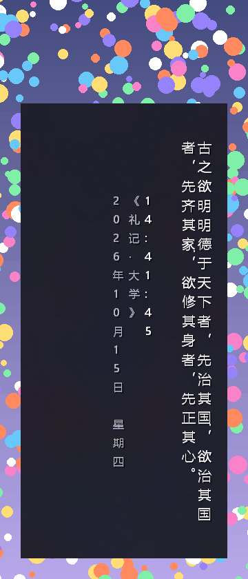

# desk-geyan · 桌面格言挂件

Rust + 纯 Win32（`windows-sys`，无 GUI 框架）实现的桌面格言 / 时钟挂件。
**毛玻璃底板 + 逐像素 alpha 的文字层**，鼠标穿透、永不抢焦点 —— 挂在桌面上不影响任何操作。

| | |
| --- | --- |
| **显示** | 时钟（可带秒）· 日期 · 格言，三块可单独开关 |
| **外观** | 字体 / 字号（整体 + 分块）/ 主色 / 日期色 / 格言色 / 字距 / 不透明度 |
| **版式** | 横版 · **竖版卷轴式**（主文竖排、列自右向左） |
| **模式** | 毛玻璃底板 / 纯文字（`Ctrl+Alt+T` 一键切） |
| **动效** | 跑马灯 · 静态 · 淡入淡出 · 呼吸，换句带过渡动效 |
| **交互** | 全局热键 + 托盘菜单；**全部配置收在一个设置面板里** |

---

## 效果预览

### 毛玻璃模式（默认）


底板是 DWM 的 Acrylic 毛玻璃：透过它能看见被模糊的桌面，文字逐像素抗锯齿地贴在板上。
图的背景是模拟桌面内容（彩色圆点），**上方未被挂件覆盖的那条是"清晰"对照** —— 挂件下方的圆点明显被柔化、压暗。



竖版卷轴式：主文**竖排列自右向左**（条幅的读法），左侧三列是落款 ——
自右向左为**时间**（主色）→ **出处** → **日期**（日期色）。
竖排的句读点号挪到本格右上角，`——` 旋转 90° 后就是中列那根竖线。

### 纯文字模式（`Ctrl+Alt+T`）


藏起底板，只剩字形本身贴在桌面上（靠文字阴影保证浅色壁纸下也可读）。
同一句格言、同一个位置，与上图对比即可看出"底板"与"独立文字层"是两回事 ——
这也是本项目的核心结构（见「为什么是两个窗口」）。

> 三张图都是**真实截屏**（含系统合成的毛玻璃），不是渲染器导出的素材。

---

## 功能

**显示内容** —— 时钟（`HH:mm` / `HH:mm:ss`，窗口窄时自动降级）· 日期 · 格言 · 文字阴影开关。

**外观与版式** —— 字体（**只列真的含汉字的**，每行用它自己的字形渲染）·
字号两档旋钮（`scale` 整体 × `clock_scale` / `quote_scale` 分块）·
主色 / 日期色 / 格言专用色 · 字距 · 不透明度 · 横版 / 竖版卷轴式。

**动效** —— 跑马灯 · 静态 · 淡入淡出 · 呼吸；换句时按「旧句淡出 → 空一拍 → 新句淡入」播放过渡
（只作用在格言上，时钟 / 日期 / 底板逐位不动）；
**悬停暂停**（光标停在挂件上 ≥300ms 就冻住阅读，离开立即恢复，暂停期间零出帧）；
竖版入场按列自右向左错峰渐显。

**交互** —— 全局热键 + 托盘菜单；**布局模式**下可拖空白处移动、拖四边缩放、
**时间日期块可单独拖到任意位置**；开机自启；全屏游戏 / 播放器运行时自动隐藏；
多显示器下按"挂件所在屏"取基准。

**格言库** —— 内置 317 条（经典格言 · 诗词名句 · 谚语俗语 · 名人名言）+ 外部 `quotes.txt`
（多文件分组、按行序轮播）；`Ctrl+Alt+F` 收藏当前句（同时复制到剪贴板），收藏夹自成一组参与轮播。

---

## 快速开始

从 [Releases](https://github.com/gmsjy/desk-geyan/releases) 下载
`desk-geyan-vX.Y.Z-windows-x64.zip`，解压后直接运行 `desk-geyan.exe` ——
免安装、不需要 Rust 或任何运行时（只用 Windows 自带的 UCRT / `vcruntime140`）。

从源码跑：

```bash
cargo run --release
```

首次运行会把自己贴在**工作区右上角**，位置 / 尺寸 / 颜色等都会记住
（写在 `%APPDATA%\DeskGeyan\config.ini`）。

想改点什么？托盘右键 →「设置…」，或按 `Ctrl+Alt+O`。

---

## 使用

### 快捷键（全是全局热键）

窗口鼠标穿透，所以所有操作都走热键和托盘菜单。默认修饰键 `Ctrl+Alt`。

| 快捷键 | 作用 | 快捷键 | 作用 |
| --- | --- | --- | --- |
| `Ctrl+Alt+H` | 显示 / 隐藏 | `Ctrl+Alt+=` / `-` | 整体字号 + / − |
| `Ctrl+Alt+C` | 显示 / 隐藏时间 | `Ctrl+Alt+M` | 切换动效 |
| `Ctrl+Alt+D` | 显示 / 隐藏日期 | `Ctrl+Alt+T` | **毛玻璃 / 纯文字** |
| `Ctrl+Alt+K` | 循环切换文字颜色 | `Ctrl+Alt+E` | **布局模式**（临时放行鼠标） |
| `Ctrl+Alt+O` | 打开**设置面板** | `Ctrl+Alt+↑` / `↓` | 调高 / 调低不透明度 |
| `Ctrl+Alt+←` / `→` | 上一条 / 下一条格言 | `Ctrl+Alt+F` | **收藏当前句子** |
| `Ctrl+Alt+P` | 总在最前 开 / 关 | `Ctrl+Alt+R` | 重新载入格言与配置 |
| `Ctrl+Alt+S` | 隐藏（到托盘） | `Ctrl+Alt+X` | 退出 |

**布局模式**是唯一能碰到窗口的时候：底板显形并画上边框，时间日期块额外框出一个框，
拖它把时间挪到任意位置（拖出边界自动夹住）；拖框外空白处移动整个挂件，拖四边缩放。
退出后立刻恢复穿透。

### 托盘菜单

托盘菜单只留高频操作，**所有设置集中在设置面板里**，两处不重复列。

| 菜单 | 内容 |
| --- | --- |
| **设置…** | 打开设置面板 —— 配置的**唯一入口** |
| 显示 / 隐藏 | 同 `Ctrl+Alt+H` |
| 格言操作 | 上一条 / 下一条 / 收藏当前句子 |
| 维护 | 重载格言 / 配置、回到右上角、重置时间日期位置 |
| 退出 | — |

### 设置面板

挂件本体点不到，托盘菜单一项一项点又太碎，所以全部配置收进**同一页**：
托盘「设置…」或 `Ctrl+Alt+O` 打开一个**普通、可点击的**顶层窗口，改哪一项都**立即生效**、不用重启。


窗口 800×620，右栏按六组排：**显示内容** · **窗口与行为** · **版式** · **动效** · **外观** · **操作**，
共 **68 个控件**（其中 40 条会真的改到配置或执行动作）。左栏换字体，选中即落盘 + 重绘挂件，
**不需要「确定」按钮**。

三条设计决定：

- **只列「真的含汉字」的字体。** 判据不靠字体名猜 —— 用 `GetGlyphIndicesW` 逐字查字形索引，
  配 `GGI_MARK_NONEXISTING_GLYPHS` 时「没有的字形」返回 `0xFFFF`，于是"有没有"变成一次可判定的比较。
- **每行用该字体自己的字形渲染**（owner-draw）。光看「SimSun」这几个字母分不出宋体长什么样。
- **所有改动走同一条写入路径**：控件不直接改配置，只发一条命令，和托盘菜单**完完全全同一条路**；
  反过来控件的状态每次都从配置重新读回，从不缓存 —— 于是「界面显示的」和「配置里的」不一致
  是一件**可以被断言抓到**的事。

### 自定义格言与收藏

在 `%APPDATA%\DeskGeyan\quotes.txt` 里一行一条，格式 `正文 —— 作者`
（作者可省略；`--`、`——`、制表符都能当分隔符；`#` 或 `;` 开头是注释）。
外部条目**排在内置 317 条之前**优先显示，改完按 `Ctrl+Alt+R` 重载。

**多文件分组**：建一个 `%APPDATA%\DeskGeyan\quotes\` 目录，里面每个 `.txt` 是一组
（`quotes.txt` 本身算第一组），组内按行序、组间**轮流**出现：

```
quotes.txt              甲一 甲二
quotes/01_乡村振兴.txt    乙一 乙二 乙三
quotes/02_古诗.txt        丙一
→ 播放序：甲一 乙一 丙一 甲二 乙二 乙三
```

轮播而不是"一组播完再下一组"，是因为组大小常差一个量级（152 条 vs 30 条），
顺序播放会让小组几分钟才露一次面。想控制组序就用 `01_` `02_` 前导零命名。

**收藏夹**：按 `Ctrl+Alt+F` 会把当前句**同时**做两件事 —— 复制到剪贴板 + 追加到
`quotes\favorites.txt`，于是收藏夹自动成为上面分组机制里的**一组**，与你的分区文件轮流出现。
它只在收藏夹内查重（收藏一句内置格言就是想让它**更常出现**，不是"已在库中"）；
两件事互不牵连（剪贴板被别的程序占着时，收藏照做）；收藏**不影响当前画面**（不换句、不重置滚动）。

**素材库**：`assets/quotes-shenlun.txt` 是 152 条申论写作素材（按乡村振兴 / 基层治理 / 为民 /
实干 / 改革 / 法治 / 修身 / 廉洁 / 诚信 / 生态 / 文化 / 家国 / 青年 / 方法 / 团结 十五类整理，
逐条标出处），复制到 `%APPDATA%\DeskGeyan\quotes.txt` 即可生效。
`docs/申论写作素材.md` 是同一批素材的可检索版。

改完格言库跑一次 `--quotes` 自检 —— 「文件写进去了」和「程序读出来了」中间隔着一个解析器，
最容易静默出错的地方（BOM 污染、注释漏进库、分隔符残留、与内置撞车、空条目）它都会查。

### 命令行

```bash
desk-geyan.exe                        # 正常启动（不常驻的命令见下）
desk-geyan.exe --autostart on|off|query   # 开机自启的查询 / 设置

# 自检与行为探测：都不常驻、跑完即退，且零副作用（配置先快照再原样写回）
--selftest    # 渲染管线 + 动效状态机 + 各可配置项的断言（64 条）
--probe       # 读回窗口样式与可见性，验证「不干扰桌面」三道闸
--clicktest   # 鼠标穿透的**行为**实测（真实光标，不读样式位）
--dragtest    # 把「按下→移动→松开」灌进真窗口过程，验证拖动链路
--quotes      # 格言库真加载一遍：BOM / 注释漏入 / 分隔符残留 / 重复
--favtest     # 收藏当前句：真的按一次 Ctrl+Alt+F，验剪贴板 / 收藏夹 / 幂等

# 性能标定
--perf        # 各档吞吐上限（µs/条）+ 空转出帧数
--dragbench   # 跟手标定：窗口移动的成本拆解 + 真实节奏 + 途中滞后
--memtest     # 内存 / 资源 soak：120 轮，判 Private Bytes 与 GDI/USER/句柄
```

想直接看渲染结果（不用盯着跑马灯等它滚过来）：

```bash
# 当前配置的一帧 → PNG（透明区域用棋盘格衬底，抗锯齿边缘看得清）
desk-geyan.exe --dump shots/a.png

# 临时试一套外观：key=value 与配置文件同源，随便覆盖
desk-geyan.exe --dump shots/b.png color=#F5D98B scale=130 clock_dx=260 show_date=false

# 竖版卷轴式 + 字距 + 格言独立配色
desk-geyan.exe --dump shots/c.png orient=vertical letter_spacing=4 quote_color=#F5D98B
```

> `--favtest` 与 `--clicktest` 会用到真实光标 / 全局热键，**跑之前先确认没有正在运行的实例**。

---

## 配置

`%APPDATA%\DeskGeyan\config.ini`，一行一条 `key=value`，改完用 `Ctrl+Alt+R` 重载。

| 键 | 含义 | 默认 |
| --- | --- | --- |
| `x` `y` `w` `h` | 位置与尺寸（物理像素） | 右上角 / 620×176 |
| `opacity` | 整体不透明度 `30-255` | `215` |
| `mode` | `glass`（毛玻璃）/ `text`（纯文字） | `glass` |
| `anim` | `marquee` / `static` / `fade` / `breathe` | `marquee` |
| `always_on_top` | 总在最前 | `true` |
| `show_clock` `show_date` `show_quote` | 三块内容的开关 | `true` |
| `seconds` | 时钟是否显示秒（窗口窄时自动降级） | `true` |
| `shadow` | 文字阴影（浅色壁纸下把字托起来） | `true` |
| `speed` | 跑马灯速度 `px/s`，`10-400` | `60` |
| `scale` | **整体**字号百分比，`30-600` | `100` |
| `clock_scale` / `quote_scale` | 时钟 / 格言相对整体字号的倍率，`30-600` | `100` |
| `font` | 字体名 | `Microsoft YaHei UI` |
| `color` | **主色**（时钟 + 格言），`#RRGGBB` | `#FFFFFF` |
| `date_color` / `quote_color` | 日期色 / 格言专用色（`unset` = 跟随主色） | `#B8B8B8` / `unset` |
| `clock_dx` `clock_dy` | 时间日期块偏移（布局模式下直接拖即可） | `0` `0` |
| `visible` | 启动时是否显示 | `true` |
| `auto_hide_fs` | 全屏应用运行时自动隐藏 | `true` |
| `orient` | `horizontal` / `vertical`（竖版卷轴式） | `horizontal` |
| `letter_spacing` | 格言字距 `0-8`（相对值，按整体字号缩放） | `0` |
| `shrink_fit` | 放不下时允许缩字号回退（100% → 85% → 70%） | `true` |
| `h_w` `h_h` `v_w` `v_h` | 两种版式各自的尺寸记忆（切版式自动带上） | 620×176 / 300×660 |

> 颜色改的是**字形本身**，不是叠一层色块：掩码层永远用白字黑底采覆盖率，颜色在最后预乘时才乘进去，
> 所以换色不影响抗锯齿质量。浅色壁纸建议 `color=#2B2B2B`，深色壁纸用白或暖黄 `#F5D98B`。
>
> 字号是「整体 × 局部」两个旋钮 —— 想要"时间很大、格言小一点"就设
> `scale=130 clock_scale=150 quote_scale=80`。
>
> **开机自启不走配置文件**：它写在 `HKCU\...\Run` 注册表里，那是唯一状态源。
> 只删自己那条值；写入前先读回原值、别人的项先备份到 `DeskGeyan_prev`；关闭时原样恢复。

---

## 实现要点

### 文字为什么能「贴」在桌面上

关键在于**不能用** `LWA_COLORKEY` / 全局 alpha 这类 8bpp 思路 —— 它们会让字形边缘变成硬边，
效果就是一块带黑框的贴片。真正的做法是每个像素各自带 alpha：`UpdateLayeredWindow` + `AC_SRC_ALPHA`。

一帧跑**三趟** GDI 绘制，得到三条互不串扰的掩码通道，然后就地预乘合成：

| 通道 | 画什么 | 怎么画 | 谁贡献颜色 |
| --- | --- | --- | --- |
| `CH_CLOCK` | 时钟 + 分隔线 | 黑底**白**字 | `color` |
| `CH_DATE` | 日期（或竖版落款） | 黑底**白**字 | `date_color` |
| `CH_QUOTE` | 格言 | 黑底**白**字 | `quote_color` |
| （阴影趟） | 全部内容 | **白底黑字** | 只贡献 alpha，恒为黑 |

三条通道能并进同一块 32bpp 位图，靠的是一条关于 GDI 的事实：**抗锯齿是逐通道线性的**——
用「只有某一位为满值」的颜色（`0x00FF0000` / `0x0000FF00` / `0x000000FF`）分别画出，
三个字节互不串扰，合成时读回就是三条掩码。整帧从 7 趟 `w*h` 降到 **3 趟**。

两个必须守住的反直觉细节：

* 字体质量只能用 `ANTIALIASED_QUALITY`。`CLEARTYPE_QUALITY` 是次像素渲染，字缘带红蓝边，进掩码就是脏边。
* 通道值**必须满值 `FF`**。用 `FE` 会让覆盖率永久缺 1/255，那就不是"无损提速"而是一次真实的画质降级。

> 通道映射（哪个字节对应哪条通道）是**实测出来的**，不是推的：32bpp `BI_RGB` DIB 在内存里是
> BGRA，而 `SetTextColor` 收的是 `COLORREF`（`0x00BBGGRR`），两者**错位**。老注释里
> "掩码取 R 通道"的说法是错的。
>
> 这条机制有个不友好的失败模式：**通道接错时画面照样好看**，只是日期画成了主色、主色画成了日期色。
> 所以断言不能看颜色、要看**字节** —— 逐条关掉时钟 / 日期 / 格言，三条通道的墨量必须各自精确归零。

### 为什么是两个窗口

毛玻璃和「文字贴合」在同一个窗口里互相打架：DWM 的 Acrylic 只能作用在**没被 GDI 画过**的像素上，
而跑马灯每 40ms 就整块重画一次；反过来底板窗口要是老实不画，文字又没地方放。

所以拆成 `下层毛玻璃底板 + 上层逐像素 alpha 文字`：

| | 样式 | 职责 |
| --- | --- | --- |
| 底板 `DeskGeyanPanel` | Acrylic accent，**从不绘制** | 只让 DWM 画它，永不污染 |
| 文字 `DeskGeyanText` | `WS_EX_LAYERED` + ULW，**恒穿透** | 每帧整块重画 |

纯文字模式 = 藏起底板（上面第 3 张效果图）；布局模式 = 把底板显出来当拖拽把手。

> **毛玻璃与非分层绑死**：给底板加 `WS_EX_LAYERED` 会把 Acrylic 整个抹掉（用 2px 棋盘格的
> 窗内清晰度实测：不 layered 时 64.7 → 1.2，layered 后回到 64.7 = 模糊消失）。
> 但它**不影响穿透** —— 早期"毛玻璃必然拦鼠标、必须挂分层宿主"的推论是**错的**，
> 已用真实光标实测证伪（顶层非分层底板下收到 0 条鼠标移动）。

### 排版层：纯函数，一帧只算一次

`src/layout.rs` 只吃「预先量好的每字步进」和度量，**不碰 GDI、不建窗口**，
所以折行、避头尾、竖版列切分、截断兜底都能用 `cargo test` 验 —— 这是把它单独拆出来的最大理由。

这一层出现之前，渲染管线里只有一条主轴，带来两个同源的缺陷：**长句静默截断**（墨迹右缘紧贴裁剪缘，
后半句和出处直接消失、连省略号都没有）与**大字号整条消失**（`scale ≥ 205%` 时格言完全不见、零提示）。

三条约定：排版**一帧只算一次**（主趟 / 日期趟 / 阴影趟共用同一份定位表）；
居中 / 右对齐在排版里一次算完；缩字阶梯每档**换字体对象重新量**（不同字号的 GDI 取整不一样，
按比例缩估算值和实际画出来的对不上）。

版心是**三段式**（时钟右侧 → 时钟下方堆叠 → 整窗），每段都有实宽。退化到整窗时格言干脆不画、
只在顶部给一句明确提示 —— 两块叠在一起比"格言没了"更难看，而唯一不允许的结果是
**「什么都不画、什么也不说」**。

### 合批：一次 `PolyTextOutW` 画完一整段

逐字 `TextOutW` 太贵：横版 66 字长句每帧要多花约 2000µs（≈37µs/字，主趟 + 阴影趟），
而这 66 个字其实只分属 3～4 条基线。合批后整帧 **3441µs → 1349µs**，
再叠上三通道并趟，现在这一档是 **872µs**。

落点是 `PolyTextOutW` + `POLYTEXTW`：一次提交**多段**、**每段自带 `(x, y)`**。
这让**竖版也吃到合批** —— 竖排每个字都在不同的 `y` 上，`TextOutW` 一个都用不上，
而 `POLYTEXTW` 每段自带坐标，60 个竖排字一次提交完。

合批的前提是「段内其余字交给 GDI 按步进推」还能落在正确位置，所以段内必须
**同一基线、同一字体、且不跨列**。（`POLYTEXTW` 里没有字体字段，所以旋转字要按字体分组、各提交一次。）

合批有两条**逐像素等价**断言盯着（横版 + 竖版各一条），拿"强制逐字绘制"当基准比对整块掩码 ——
优化必须被证伪过才算数。

> 竖版那条的用例刻意带上 `——` 与 `……`，并把「有旋转字」写进判据：旋转字分组是横版
> **永远走不到**的分支，文本一旦被改回纯汉字，这条断言就退化成横版那条的副本。

### 动效：顺序相位 + 分通道 alpha

换句动效是一个纯逻辑状态机（`src/transition.rs`，不碰 GDI，全部边界可单测）：

```
Dwell(4~10s) → Leave(160ms) → Gap(140ms) → Arrive(260ms) → Dwell …
```

旧句淡出 → **空 140ms** → 新句淡入 + 微位移。中间那个 `Gap` 是重点：
顺序相位**从机制上消灭交叉淡入重影** —— `Gap` 期内新句掩码恒为 0、旧句 alpha 已 ≤35%，
两者不可能同像素可辨。dwell 按字数算（长句多留阅读时间，短句不频繁打断）。

**分通道 alpha**：动效只动格言，时钟 / 日期 / 底板逐位不动。掩码字节本身就是 alpha 的原材料，
而合成是唯一乘颜色的地方 —— 所以给合成加一个格言系数即可。`k = 255` 时整数恒等，
**稳态帧与改动前逐位相同**（像素级 A/B 证实）。

**悬停暂停**：光标在挂件上连续停 ≥300ms 就冻结（不对称迟滞 ——「想读」要确认、「不读了」不用猜），
且**暂停期间一帧不出**；离开立即恢复。呼吸不冻结（氛围不是阅读内容）。

### 性能：单帧红线 1200µs

红线是**单帧 1200µs**（1000Hz 鼠标每条消息预算 1000µs，拖动期间约每 8ms 出一帧）。
`--perf` 里有一档专门量最坏帧，每档都读回两个独立事实（画 + 上屏 µs），不只看总耗时：

| 档 | 画 | 上屏 | 合计 | 红线 |
| --- | --- | --- | --- | --- |
| 默认一帧 620×176（一行短句） | 618 | 51 | 684 | ✅ |
| 最坏帧 · 横版多行 620×260 | 665 | 56 | 721 | ✅ |
| 最坏帧 · 竖版卷轴 300×660 | 729 | 66 | 795 | ✅ |

（同一台机、每档 200 次平均；跑与跑之间有 ±5% 抖动，别把某一次的个位数当趋势。）
这三档曾经两超一过（1349µs / 2634µs），结清它们的是两处改动：**三通道并趟** + **合批**。

### 拖动为什么跟手

拖起来"粘手"有两层成因。**第一层：画得没必要** —— 位置变化不影响任何一个像素，
掩码、合成、结果都和窗口在哪无关，那一帧对"窗口挪了 1px"零贡献却要花 ~800µs。
**第二层：位置落定本身也有成本**（底板 `SetWindowPos` + 文字层上屏 ~340µs）。

预算是死的：1000Hz 鼠标每 1ms 一条消息。旧做法一条消息吃掉 1290µs，消息队列必然越积越长。

| 措施 | 做法 |
| --- | --- |
| **只挪不画** | 移动路径只做「底板 `SetWindowPos` + 文字层 `UpdateLayeredWindow`」，零重绘 |
| **状态与画面解耦** | 状态每条消息即时更新；画面走 `dirty` + 8ms 节流，松手强制出一帧停在最终状态 |
| **位置也节流** | 窗口位置走 8ms 节拍，停手后由定时器补最后一格 |
| **空转不出帧** | `needs_frame()` 按时钟刻度与动效类型判断这一拍会不会变 |

真实节奏（每条等 1000µs，模拟 1000Hz 连续甩鼠标）下：节流关 452µs/条 → 节流 8ms **172µs/条**（2.6×）；
松手位移 800/800 一条不丢；途中滞后峰值 8px = 恰好一个节拍（这是节流的定义性代价，不是丢帧）。

> 位置节流带来一个必须配套的前提：`cfg.x/y` 从此表示「**目标**位置」，不再等于窗口真实位置。
> 所以任何把客户区坐标还原成屏幕坐标的地方，都必须读窗口**真实位置**，不能拿 `cfg` 顶替 ——
> 否则窗口落后期间会把已经欠着的位移重复计入，误差按三角数放大，表现就是**鼠标一动、窗口乱飘**。
>
> 代价是每条移动消息多一次 `GetWindowRect`（约 50µs）。**这个钱值得花**：那条 bug 的根因恰恰是
> 「用一个记账值代替窗口真实位置」。

### 不干扰桌面

| 样式 / 机制 | 作用 |
| --- | --- |
| `WS_EX_TRANSPARENT` + `WM_NCHITTEST → HTTRANSPARENT` | 鼠标消息穿透到下层，点图标、拖文件照旧（两条独立机制，都做） |
| `WS_EX_NOACTIVATE` | 永不抢焦点，正在打字的输入框不会被打断 |
| `WS_EX_TOOLWINDOW` | 不进任务栏、不进 Alt-Tab |
| 底板只在该显形时显形 | 纯文字模式下必须隐藏，否则是一片"看不见却拦鼠标"的窗口 |
| 全屏守卫 | `SHQueryUserNotificationState` **只认 D3D 全屏**，游戏 / 全屏播放时收起，退出后恢复 |

**样式位不等于行为。** 这里踩过一个真坑：`--probe` 一路 PASS（样式位全都在），
而底板把整块面积的鼠标点击全吃掉了。现在有一条 `--clicktest`：把光标挪到挂件正中，
数**我们自己的窗口过程收到几条鼠标移动消息**，用真实行为当判据 —— 它同时钉住
「毛玻璃模式下底板显形 + 收到 0 条」这一条（毛玻璃与穿透同时成立）。

---

## 踩过的坑

1. **`SetWindowCompositionAttribute` 不在 SDK 导入库里** —— 它是 user32 的未文档化导出
   （毛玻璃的唯一入口），`#[link]` 声明会直接 `LNK2019`，只能运行时 `GetProcAddress`。
2. **`GetProcAddress(GetModuleHandle(NULL), ...)` 找不到 user32 的函数** ——
   必须显式 `GetModuleHandleW("user32.dll")`。这个 bug 一度让 Acrylic 静默降级。
3. **阴影层用了比字形更宽的裁剪区，在时钟上盖了一层黑影** —— 阴影只抬 alpha、不碰颜色，
   落在没有字形的像素上合成出来就是半透明黑。上一版就存在，靠肉眼看截图没发现，
   是加了 `--dump` 导出放大对比才看出来的。修法是把"算裁剪边界"和"画不画那根线"拆开。
4. **`&mut` 别名 UB 让测量数据凭空失真** —— 消息泵里同一对象同时存在多个 `&mut` 别名，
   编译器把字段读**提升成了循环外常量**：消息计数器恒为 0，跟手延迟报 795px（实际 8px）。
   教训：**诊断代码读状态必须走裸指针或独立静态量**。
5. **基准测试自己也会骗人** —— 成本拆解每档都从同一个起点挪，而上一档结束时窗口已经停在终点，
   于是"踱出 0 px"：耗时照测、位移恒 0（七档里五档如此）。**每个数字都得有一个独立事实
   （位移、像素、句柄数）在旁边盯着。**
6. **「窗口位置」不能用「目标位置」代替** —— 这是"鼠标一动、窗口乱飘"的根因（见上）。
   更值得记的是它差点从测试里溜过去：原来的用例灌**恒定**客户区坐标，那个假设只在关掉节流时成立，
   开着节流时恰好把三角数误差**伪装成了正常的等差位移**，断言一路绿灯。
7. **「属性写了」和「行为成立」是两件事** —— `WS_EX_TRANSPARENT` 在非分层顶层窗口上不生效，
   `--probe` 每次报 PASS，实际底板把点击全吃掉了。而且第一版断言把检查放在状态重算**之后**，
   于是**永远绿**。**别拿属性当行为；断言的时机是断言的一部分。**
8. **一条错误的「硬约束」比没有结论贵得多** —— "毛玻璃必然拦鼠标"这条错推论在 README 里
   躺了很久，看起来像经过验证的架构结论。为改它先按老方案写了约 120 行宿主窗口改造，
   跑回归才发现子窗口上 Acrylic 直接失败。**动手前先花一分钟做反向对照**：
   不改代码、只改测试里的一个枚举值，一次就能得到答案。
9. **`ExtTextOutW` + `ETO_PDY` 不能用来"按定位表一次画完"（实测否掉）** ——
   `(dx,dy)` 的语义在文档里含糊，两种自然解释都复现不了定位表（一种墨量 3122 / 一种位移一路累加）。
   后来竖版靠 `PolyTextOutW` 拿到了合批 —— 它每段自带坐标，语义是"多段各画各的"。
10. **性能断言的"参考值"本身也可能是错的** —— 强制逐字绘制的基准只实现了一半
   （仍按分段画），基准自己就是错的，报了三种不同的"不同"。**做 A/B 断言之前，先证明 B 是它声称的那条路。**
11. **「通道即语义」接错时画面照样好看** —— 把时钟与日期的通道对调，红白像素数只是互换，
    老断言照样绿。修法是换判据：不看颜色看**字节**，且用**开关反证**（逐条关掉某类内容，对应通道墨量必须精确归零）。
12. **阴影不能改成"从掩码位移采样"（实测不等价）** —— 逐像素比对：差异 2.03%、
    通道差上界 65/255、且**全部朝变暗**（单方向的系统性差异 = 有系统性原因，不能当噪声放过）。
    **「看起来等价」不是等价。**
13. **换了基线配置、字体没跟着换，"半套状态"让 5 条断言一起红** —— 测试夹具里的"配置"是一个整体
    （`cfg` + 由它派生的字体对象 + 窗口几何），只换一半会造出一种真实运行中不可能出现的状态。
14. **真实光标的残留消息混进了合成拖拽** —— 系统往队列里塞过一条带真实坐标的鼠标消息，
    恰好夹在合成事件之间被泵出来，把首条位移带偏。修法是合成按下**之前先把队列排空**。
    又是"基准的轨迹必须和被测场景一致"。
15. **`InvalidateRect` 的 `bErase` 是"要不要把这块擦干净"** —— 忘了它，换字体时新字形直接盖在
    旧字形残留像素上，越换叠得越多。**「重画」这个词默认包含「先擦掉旧的」，但 Win32 不替你做。**
16. **`PrintWindow` 读的是"已合成的表面"—— 抓图前不 `pump()`，断言会「空绿」** ——
    换色后只是挂了个"待重绘"标记，而 `PrintWindow` 不会替你触发重绘，抓到的永远是**上一帧**。
    凡是"读回一个已经渲染好的结果"的断言，都要先问：**我要读的那一帧，到底生成了没有？**
17. **「章节标题」不占格子，但必须自己把行推进一格** —— 否则它会落在上一行的半空中、与控件重叠。
    肉眼几乎看不出来（重叠的是一行文字和一行控件），是靠把整份布局 dump 出来才发现的。
    **「不占格子」不等于「不消耗布局」。**
18. **合批的判据写成了"`src` 相邻"，但真正的前提是"`x` 按步进相接"** ——
    注释声称的"折行会把不相邻的两个字排到同一行"经 230 万例穷举扫描**命中 0 次**（该场景不存在）；
    反倒是竖版极矮版心（每列一字）下，相邻**列**的字同 `y` 且 `src` 连续，三条判据全满足，
    整列被沿一条基线画成一行（实测 669px / 3.48% 偏差）。修法是加一条"**不跨列**"。
    **判据要写成"被测代码真正需要的不变量"，不是"看起来等价的性质"**；
    **覆盖边界要按"参数退化到什么程度"去补**，不是按"代码里有哪些分支"。

---

## 项目结构

```
src/
  main.rs        入口 + 各 --xxx 验证入口的分派
  app/           应用主体（原 app.rs，9151 行拆成 8 个模块）
    mod.rs       App 状态 + 建窗引导 + 进程入口 + 模块间共享面
    window.rs    Win32 窗口层：创建 / Acrylic / 穿透 / 几何 / 可见性
    render.rs    帧构建与绘制：三通道掩码 → 合批 → ULW 上屏
    frame.rs     帧调度：tick / step / needs_frame / 全屏守卫
    input.rs     窗口过程、拖拽、命中判定、热键、托盘与菜单
    verify/      验证与基准（自检 / 探测 / 单帧导出 / 性能 / 拖动 / 内存）
  layout.rs      **纯函数排版引擎**：折行 + 避头尾 + 缩字回退 + 竖版列切分与标点归位
  transition.rs  **纯逻辑换句动效状态机**：顺序相位 + 缓动 + 分通道 alpha 系数（不碰 GDI）
  gfx.rs         渲染核心：DIB / 一趟画三条掩码通道 / 预乘合成 / PolyTextOutW 逐段合批 / ULW
  config_ui.rs   **设置面板**：表格驱动的控件布局 + 系统字体枚举 + owner-draw 字体列表
  quotes.rs      内置格言库 + 多文件分组（round-robin）+ --quotes 自检
  favorites.rs   收藏夹：当前句子 → quotes/favorites.txt（独立一组，查重幂等）
  autostart.rs   开机自启：Run 键读写 + 备份/恢复决策（纯函数可测）
  config.rs      配置读写 + 预设（字体 / 颜色 / 字号档位）
  clipboard.rs   剪贴板读写（CF_UNICODETEXT，自持 FFI + 打开失败重试）
  ffi.rs         未文档化 API（毛玻璃、DPI、注册表、通知状态）的解析与声明
  consts.rs      Win32 常量（自持，不依赖 crate 的常量导出）
  util.rs        宽字符串 / 时间格式化 / 颜色解析
  png.rs         极简 PNG 写出（stored deflate，零依赖），只给 --dump 用
assets/quotes-shenlun.txt   申论写作素材 152 条
docs/申论写作素材.md          同一批素材的可检索版
tools/glass_shot.py          效果图抓屏脚本（毛玻璃是 DWM 合成的，--dump 抓不到）
```

## 环境要求

Windows 10 1803+ 或 Windows 11（Acrylic 需要 1803+，低版本自动降级为自绘实心底板，仍可读可用）。
Rust 1.77+（用到了 C 字符串字面量）。

## 许可证

[MIT License](LICENSE) —— 可自由使用、修改、分发与商用，仅需保留版权声明。
