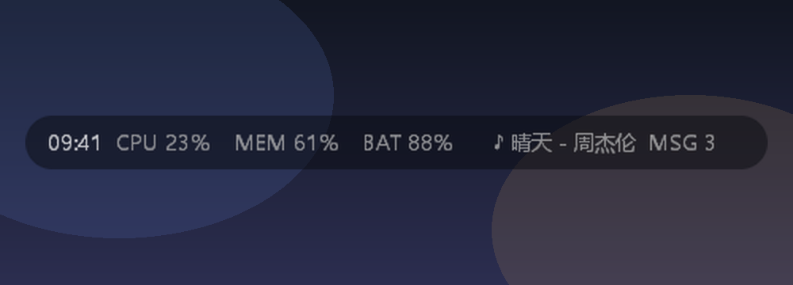
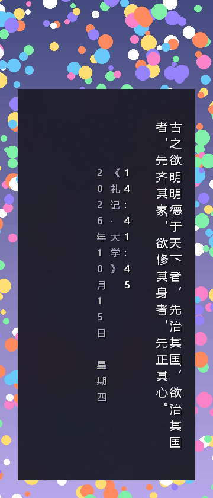
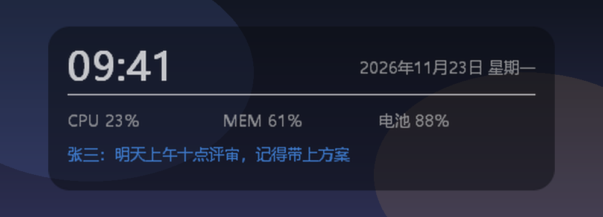
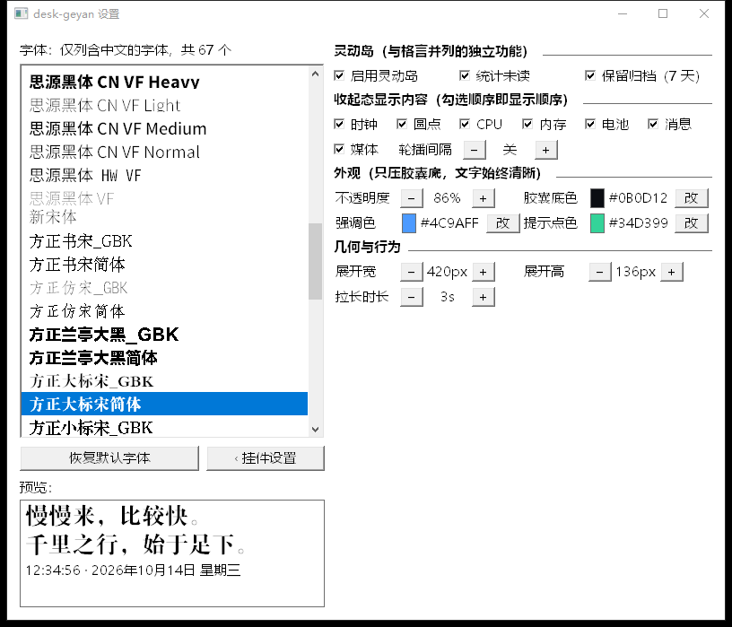

# desk-geyan · 桌面格言挂件 + 灵动岛

Rust + 纯 Win32（`windows-sys`，无 GUI 框架）实现的两个桌面小工具：
**一块能看、能读的格言牌**，和**一条贴在屏幕顶部的状态胶囊**。



两个功能**各自独立**：各有自己的窗口、开关、配置和节拍，关掉一个不影响另一个。
挂件的卖点是「好看且不碍事」，岛的卖点是「不用切窗口就知道现在几点了、谁找你了、在放什么」。

| | 桌面格言挂件 | 灵动岛 |
| --- | --- | --- |
| **位置** | 桌面右上角（可拖） | 屏幕顶部居中 |
| **本体** | 毛玻璃底板 + 逐像素 alpha 文字层（两个窗口） | 单个分层窗口，胶囊自绘 |
| **显示** | 时钟 · 日期 · 格言 | 时钟 · 绿点 · CPU · 内存 · 电池 · 消息 · 媒体 |
| **形态** | 横版 / 竖版卷轴，四档动效 | 收起 34px / 拉长 / 展开 420×136 |
| **交互** | 全局热键 + 托盘 + 设置面板 | 悬停展开（唯一需要鼠标的地方） |
| **穿透** | 始终穿透，布局模式下临时放行 | 始终穿透 |
| **配置** | `%APPDATA%\DeskGeyan\config.ini` | 同一个文件，`island_*` 一组键 |

---

## 效果预览

### 桌面格言：毛玻璃（默认）


底板是 DWM 的 Acrylic 毛玻璃：透过它能看见被模糊的桌面，文字逐像素抗锯齿地贴在板上。
图的背景是模拟桌面内容（彩色圆点），**上方未被挂件覆盖的那条是"清晰"对照** ——
挂件下方的圆点明显被柔化、压暗。



竖版卷轴式：主文**竖排列自右向左**（条幅的读法），左侧三列是落款 ——
自右向左为**时间**（主色）→ **出处** → **日期**（日期色）。
竖排的句读点号挪到本格右上角，`——` 旋转 90° 后就是中列那根竖线。

### 桌面格言：纯文字（`Ctrl+Alt+T`）


藏起底板，只剩字形本身贴在桌面上（靠文字阴影保证浅色壁纸下也可读）。
同一句格言、同一个位置，与上图对比即可看出"底板"与"独立文字层"是两回事 ——
这也是本项目的核心结构（见「为什么是两个窗口」）。

> 这三张是**真实截屏**（含系统合成的毛玻璃），不是渲染器导出的素材。

### 灵动岛：收起态


`09:41 CPU 23% MEM 61% BAT 88% ♪ 晴天 - 周杰伦 MSG 3` ——
七项能勾的片段都在这条 34px 高的胶囊里，从左到右就是设置面板里的勾选顺序。
胶囊底默认 `#0B0D12 @ 71%`，所以背景的光斑会透出来；文字始终不透明。



悬停 180ms 就展开：时钟放大、日期靠右、状态一行、第三行是最近一条消息正文。
这里只有悬停才展开 —— 拉长（新消息到达时变宽）是另一回事，高度不变。

> 这两张是 `--dump-island` 的**离屏渲染结果**叠在模拟壁纸上（透明度只有在有背景时才看得见），
> 不是屏幕截屏。真机上的毛玻璃边缘由 DWM 合成，会更柔和一点。

### 设置面板



挂件本体点不到、托盘菜单一项项点又太碎，所以全部配置收进**两页**：
左栏换字体，右栏上页是挂件、下页是灵动岛。改哪一项都**立即生效**，没有「确定」按钮。

---

## 快速开始

从 [Releases](https://github.com/gmsjy/desk-geyan/releases) 下载
`desk-geyan-vX.Y.Z-windows-x64.zip`，解压后运行 `desk-geyan.exe` ——
免安装、不需要 Rust 或任何运行时（只用 Windows 自带的 UCRT / `vcruntime140`）。

> 解压出来的文件请**放在一起**：`desk-geyan.exe` 启动时会去同目录读 `quotes-builtin.txt`
> （内置格言库）。只把 exe 单独拷走的话，程序会照常运行，但画面上只有一句
> 「未找到格言库文件 quotes-builtin.txt」的提示 —— 这是有意为之的退化，不会静默空转。

从源码跑：

```bash
cargo run --release
```

首次运行会把自己贴在**工作区右上角**，位置 / 尺寸 / 颜色等都会记住
（写在 `%APPDATA%\DeskGeyan\config.ini`）。灵动岛默认是**关**的，
打开方式：`Ctrl+Alt+O` → 切到第二页「灵动岛」→ 勾「启用灵动岛」。

想改点什么？托盘右键 →「设置…」，或按 `Ctrl+Alt+O`。

---

## 桌面格言

### 快捷键（全是全局热键）

窗口鼠标穿透，所以所有操作都走热键和托盘菜单。默认修饰键 `Ctrl+Alt`。

| 快捷键 | 作用 | 快捷键 | 作用 |
| --- | --- | --- | --- |
| `Ctrl+Alt+H` | 显示 / 隐藏 | `Ctrl+Alt+=` / `-` | 整体字号 + / − |
| `Ctrl+Alt+C` | 显示 / 隐藏时间 | `Ctrl+Alt+M` | 切换动效 |
| `Ctrl+Alt+D` | 显示 / 隐藏日期 | `Ctrl+Alt+T` | **毛玻璃 / 纯文字** |
| `Ctrl+Alt+K` | 循环切换文字颜色 | `Ctrl+Alt+E` | **布局模式**（临时放行鼠标） |
| `Ctrl+Alt+O` | 打开**设置面板** | `Ctrl+Alt+↑` / `↓` | 调高 / 调低不透明度 |
| `Ctrl+Alt+←` / `→` | 上一条 / 下一条格言 | `Ctrl+Alt+F` | **收藏当前句子** |
| `Ctrl+Alt+P` | 总在最前 开 / 关 | `Ctrl+Alt+R` | 重新载入格言与配置 |
| `Ctrl+Alt+空格` | **暂停轮播**（固定当前句） | `Ctrl+Alt+S` | 隐藏（到托盘） |
| `Ctrl+Alt+X` | 退出 | | |

**布局模式**是唯一能碰到窗口的时候：底板显形并画上边框，时间日期块额外框出一个框，
拖它把时间挪到任意位置（拖出边界自动夹住）；拖框外空白处移动整个挂件，拖四边缩放。
退出后立刻恢复穿透。

### 托盘菜单

托盘菜单只留高频操作，**所有设置集中在设置面板里**，两处不重复列。

| 菜单 | 内容 |
| --- | --- |
| **设置…** | 打开设置面板 —— 配置的**唯一入口** |
| 显示 / 隐藏 | 同 `Ctrl+Alt+H` |
| 格言操作 | 上一条 / 下一条 / 收藏当前句子 |
| 播放 | **暂停轮播**、**仅播放收藏夹** |
| 维护 | 重载格言 / 配置、回到右上角、重置时间日期位置、**备份配置与收藏**、**导出诊断报告** |
| 分辨率适配 | **适应当前屏幕**、**跟随屏幕 DPI 缩放**（开关） |
| 退出 | — |

> 「适应当前屏幕」是换显示器 / 改缩放比例之后的一键重落：窗口按工作区同比缩，
> 字号跟着同一个系数缩，然后回到该屏右上角。窗口尺寸的上界就是工作区。
>
> 「跟随屏幕 DPI」关着时 `scale` 就是最终字号百分比；打开后同一份配置
> 在 100% / 150% / 200% 的屏上**物理尺寸一致**。

### 设置面板

面板是**普通、可点击的顶层窗口**（800×640 逻辑像素），**两页**：
上页挂件、下页灵动岛。共 **66 条可点命令**，其中数值行是「− 值 +」三段式。

左栏列出系统里**真的含汉字**的字体（本机枚举到 67 个，每台机器不同），每行用该字体自己的字形渲染，
选中即落盘 + 重绘挂件。

三条设计决定：

- **只列「真的含汉字」的字体。** 判据不靠字体名猜 —— 用 `GetGlyphIndicesW` 逐字查字形索引，
  配 `GGI_MARK_NONEXISTING_GLYPHS` 时「没有的字形」返回 `0xFFFF`，于是"有没有"变成一次可判定的比较。
- **每行用该字体自己的字形渲染**（owner-draw）。光看「SimSun」这几个字母分不出宋体长什么样。
- **所有改动走同一条写入路径**：控件不直接改配置，只发一条命令，和托盘菜单**完完全全同一条路**；
  反过来控件的状态每次都从配置重新读回，从不缓存。

面板是 per-monitor DPI aware 进程里的普通窗口，从 100% 屏拖到 150% 屏会**整块换挡**
（字号 / 行高 / 间距 / 每格矩形一起按 `dpi/100` 放大）。布局常量全部按 96 dpi 写在
`config_ui.rs` 里，换算只发生在两个边界：进来时客户区 ÷ 倍率、出去时矩形 × 倍率。

> **没有滚动条。** 所以「排不下」等于「看不见」，而且不报错。表格即规格，
> 自检直接问布局函数要高度余量（现在 629/660，余 31px）与矩形交叠 —— 加一行就会红。

### 格言库与收藏

**内置库是个普通文本文件**：`quotes-builtin.txt` 放在 `desk-geyan.exe` **同一目录**，
一行一条，`#` 开头是注释。**不编进二进制** —— 455 条文案编进去会让 exe 多 18 KB，
而这些文案跟渲染管线一行都无关。代价是它成了安装完整性的一部分：缺了就只有一句提示语
（`--selftest` / `--quotes` 会把缺件直接判红）。

想自己改内容，**不要改这个文件**（升级覆盖安装会被替换）：复制一份到
`%APPDATA%\DeskGeyan\quotes.txt` 再编辑，外部库优先显示，改完按 `Ctrl+Alt+R` 重载。

格式是 `正文 —— 作者`（作者可省略；`--`、`——`、制表符都能当分隔符；`#` 或 `;` 开头是注释）。
**编码**：UTF-8 首选；读不到时再按系统 ANSI 代码页解一次（中文 Windows 上就是 GBK），
所以记事本「另存为 ANSI」也能用。这条由 `--selftest` 拿**真实 GBK 字节**守着。

**多文件分组**：建一个 `%APPDATA%\DeskGeyan\quotes\` 目录，每个 `.txt` 是一组
（`quotes.txt` 本身算第一组），组内按行序、组间**轮流**出现：

```
quotes.txt              甲一 甲二
quotes/01_乡村振兴.txt    乙一 乙二 乙三
quotes/02_古诗.txt        丙一
→ 播放序：甲一 乙一 丙一 甲二 乙二 乙三
```

**收藏夹**：`Ctrl+Alt+F` 把当前句**同时**做两件事 —— 复制到剪贴板 + 追加到
`quotes\favorites.txt`，于是收藏夹自动成为上面分组机制里的**一组**。
它只在收藏夹内查重（收藏一句内置格言是想让它**更常出现**）；两件事互不牵连；
收藏**不影响当前画面**（不换句、不重置滚动）。

**素材库**：`assets/quotes-shenlun.txt` 是 146 条申论写作素材（十五类，逐条标出处），
复制到 `%APPDATA%\DeskGeyan\quotes.txt` 即可生效；`docs/申论写作素材.md` 是可检索版。

### 备份与诊断

托盘「维护」组里有两项不用打开文件夹、也不用记路径的操作：

- **备份配置与收藏…** → `<数据目录>\backups\<YYYYMMDD-HHMMSS>\`，复制 `config.ini`、
  `quotes.txt` 和 `quotes/` 下每个分组文件，另附一份 `BACKUP.txt` 清单。同一秒内连按两次
  **不会**覆盖前一次 —— 目录名后缀按 `-2`、`-3` 递增。回滚就是把文件拷回去。
- **导出诊断报告…** → `<数据目录>\diagnostics.txt`。release 是 Windows 子系统，
  `--selftest` 的控制台输出在双击场景下根本看不到，于是现场信息落成普通文本：
  版本 / 窗口几何 / DPI / 外观 / 播放状态 / 全屏守卫 / 资源与错误码 / 自启实况 / 词库条数。
  报告**不写格言正文**，贴给别人看不会带出你收藏了什么。

---

## 灵动岛

### 它显示什么

七个片段，**勾选顺序就是显示顺序**（`island_items=clock,dot,cpu,mem,battery,msg,media`）：

| 片段 | 内容 | 数据从哪来 |
| --- | --- | --- |
| `clock` | `HH:mm`（展开态可带秒） | 系统时间 |
| `dot` | 一个会呼吸的绿点 | 有新事件（未读数 > 0 或刚弹了通知） |
| `cpu` | `CPU 23%` | `GetSystemTimes` 两次采样 |
| `mem` | `MEM 61%` | `GlobalMemoryStatusEx` |
| `battery` | `BAT 88%` / `BAT 88%+`（充电） | `GetSystemPowerStatus` |
| `msg` | `MSG 3` 或通知正文 | `events\*.msg` 文件 + 系统通知库 |
| `media` | `♪ 晴天 - 周杰伦` | 系统媒体会话（SMTC） |

**不可用的项自动不占位**：台式机没有电池就只是不画 `BAT`，不会留空位或 `--`。
数值格用**定宽槽位**（`CPU 100%` 的宽度当基准），所以 1% 和 100% 之间来回跳时胶囊不会抽动。

### 三种形态，只有一种能用鼠标触发

| 形态 | 触发 | 尺寸 | 说明 |
| --- | --- | --- | --- |
| **收起** | 常态 | 34px 高，宽度由内容定（上限 560） | 一排片段 |
| **拉长** | 新消息到达（`island_peek_ms`，默认 3s） | 高度不变，宽度变大 | 让出状态三格与媒体，显示来源 + 正文 |
| **展开** | 光标悬停 180ms | 默认 420×136 | 时钟放大 / 日期 / 状态行 / 消息正文 |

移开后有 **620ms 宽限**才收起（明显长于 180ms 的进入延时：防手抖、防闪回）。
展开状态下停 1.2s 记为「已读」，绿点熄灭。

**分页**：片段总宽超过上限时按页轮播（`island_rotate` 秒/页，默认 0 = 不轮播）。
`island_rotate=0` 时第 2 页**永远不会出现** —— 所以默认上限必须按最坏组合留够，
否则超宽不是"翻页"而是"静默丢内容"。

### 消息从哪来

**入口一：文件**。往 `%APPDATA%\DeskGeyan\events\` 丢一个 `*.msg`（UTF-8 文本），
内容就是消息正文。这是给别人留的协议口 —— 任何脚本、构建系统、监控都能往里写：

```bash
echo "CI · 构建完成" > "%APPDATA%\DeskGeyan\events\ci.msg"
```

读完的文件按 `island_events_keep` 处理：归档进 `events\seen\` 留 7 天，或读完即删。
未读数就是 `events\` 里的文件数（关掉归档时退回「本次运行累计」）。

**入口二：系统通知**。直接读 Windows 自己的通知库
`%LOCALAPPDATA%\Microsoft\Windows\Notifications\wpndatabase.db`，
把最近一条 toast 的标题 / 正文取出来。**零新依赖**：`winsqlite3.dll` 是系统自带，
运行时 `LoadLibraryW` + `GetProcAddress`。

**入口三：媒体会话**。走 SMTC（`GlobalSystemMediaTransportControlsSessionManager`），
拿到正在播放的标题、艺人、播放状态。浏览器（Edge / Chrome）、网易云、Spotify 都走这条路。

两段自由文本共用 `Samples.msg` 这一格（语义 = 最近一条事件）：
系统通知排在文件之后（文件可能是几分钟前丢的，通知更「现在」）。

### 通知的三个边界（都不是 bug）

1. **微信读不到。** 微信 4.x 的窗口是自绘的（UIA 只能看到 38 个匿名 Pane），
   本地库 SQLCipher 加密、日志 mars 加密，桌面 exe 又没有 package identity
   （拿不到 `UserNotificationListener`）。所以微信消息只能走「入口一」自己写文件。
2. **库是只读快照。** 你在通知中心点「清除」，行**不会**从库里删 ——
   所以程序无法知道「这条你看过了」。现在的语义是：绿点呼吸 10s 后转常亮，
   悬停展开看过 1.2s 才算已读。
3. **冷启动只建基线。** 第一次采样只记住「当前最新是哪条」，不弹。
   否则每次启动都会把库里最新一条（可能是几天前的）重新弹一遍。

### 外观

| 项 | 默认 | 说明 |
| --- | --- | --- |
| 胶囊底色 | `#0B0D12` | 深色半透明，浅色壁纸下也压得住白字 |
| 底不透明度 | `180/255`（≈71%） | **只压胶囊底**，文字不透明度独立；再乘整体 `opacity` |
| 强调色 | `#4C9AFF` | 展开态消息行的颜色 |
| 提示点色 | `#34D399` | 与强调色分开：一个表示「有新东西」，一个表示「信息」 |
| 展开尺寸 | 420×136 | 逻辑像素，运行时乘 DPI |
| 圆角 | 收起 17 / 展开 18 | 取高度的一半附近，看起来像胶囊而不是圆角矩形 |

透明度可以在面板里按 5% 一档调（`−` / `+`），下限 6%：
再低胶囊就彻底看不见了，而岛是**鼠标穿透**的 —— 只能靠设置面板找回来。

### 宽度预算：为什么标题会被截断

媒体标题是自由文本（B 站标题 30 字），而胶囊有硬上限。所以按「这一排还有没有别的项」分两档：

| 档位 | 触发条件 | 标题可见字数 | 实测宽度 |
| --- | --- | --- | --- |
| 无事件 | 只有时钟 + 状态三格 | 20 字 | 463px |
| 有事件 | 出现 `MSG n` 或绿点在 | 11 字 | 527px |
| 让位 | 绿点呼吸期正在显示通知正文 | 整段不画 | — |

第三档是实测逼出来的：12 字通知正文 + 20 字媒体叠在一排是 **625px**，必然分页。
而这一刻「谁发了什么」比「在放什么」重要。歌曲还在放，绿点转常亮后媒体自动回来。

---

## 命令行与自检

```bash
desk-geyan.exe                            # 正常启动
desk-geyan.exe --autostart on|off|query   # 开机自启的查询 / 设置

# 自检与行为探测：都不常驻、跑完即退，零副作用（配置先快照再原样写回）
--selftest     # 渲染管线 + 动效状态机 + 排版 + 设置面板控件清单（66 条命令）
--islandtest   # 灵动岛 25 步：窗口生命周期 / 形状 / 分页 / 消息管道 / 通知与媒体
--probe        # 读回窗口样式与可见性，验证「不干扰桌面」三道闸
--clicktest    # 鼠标穿透的**行为**实测（真实光标，不读样式位）
--dragtest     # 把「按下→移动→松开」灌进真窗口过程，验证拖动链路
--quotes       # 格言库真加载一遍：BOM / 注释漏入 / 分隔符残留 / 重复
--favtest      # 收藏当前句：真的按一次 Ctrl+Alt+F，验剪贴板 / 收藏夹 / 幂等
--notifprobe   # 读一条系统通知（打印 handler / 标题 / 正文），不写配置
--mediaprobe   # 问一次媒体会话（app / 标题 / 是否在播），不写配置

# 性能标定
--perf         # 各档吞吐上限（µs/条）+ 空转出帧数
--dragbench    # 跟手标定：窗口移动的成本拆解 + 真实节奏 + 途中滞后
--memtest      # 内存 / 资源 soak：120 轮，判 Private Bytes 与 GDI/USER/句柄
```

想直接看渲染结果（不用盯着跑马灯等它滚过来）：

```bash
# 挂件当前配置的一帧 → PNG（透明区域用棋盘格衬底）
desk-geyan.exe --dump shots/a.png color=#F5D98B scale=130 clock_dx=260 show_date=false

# 灵动岛：state=compact|expanded，片段与数值都能覆盖
desk-geyan.exe --dump-island shots/b.png state=expanded \
  items=clock,dot,cpu,mem,battery,media,msg cpu=23 mem=61 battery=88 unread=3 \
  media="晴天 - 周杰伦"

# 设置面板两页各导出一张（审查 / 宣传用）
desk-geyan.exe --cfgshot shots/
```

> `--favtest` 与 `--clicktest` 会用到真实光标 / 全局热键，**跑之前先确认没有正在运行的实例**。
> `--selftest` 与 `--islandtest` 可以带着运行中的实例跑（窗口判据只认本进程 PID），
> 但它们仍会读你的真实格言库 —— 想完全隔离就设 `DG_DATA_DIR` 指向空目录。

---

## 配置

`%APPDATA%\DeskGeyan\config.ini`，一行一条 `key=value`，改完用 `Ctrl+Alt+R` 重载。
`DG_DATA_DIR` 可以整份改到别处（便携模式）。

### 挂件

| 键 | 含义 | 默认 |
| --- | --- | --- |
| `x` `y` `w` `h` | 位置与尺寸（物理像素） | 右上角 / 620×176 |
| `opacity` | 整体不透明度 `30-255` | `215` |
| `mode` | `glass`（毛玻璃）/ `text`（纯文字） | `glass` |
| `anim` | `marquee` / `static` / `fade` / `breathe` | `marquee` |
| `always_on_top` | 总在最前 | `true` |
| `show_clock` `show_date` `show_quote` | 三块内容的开关 | `true` |
| `seconds` | 时钟是否显示秒（窗口窄时自动降级） | `true` |
| `shadow` | 文字阴影（浅色壁纸下把字托起来） | `true` |
| `speed` | 跑马灯速度 `px/s`，`10-400` | `60` |
| `scale` | **整体**字号百分比，`30-600` | `100` |
| `clock_scale` / `quote_scale` | 时钟 / 格言相对整体字号的倍率，`30-600` | `100` |
| `font` | 字体名 | `Microsoft YaHei UI` |
| `color` | **主色**（时钟 + 格言），`#RRGGBB` | `#FFFFFF` |
| `date_color` / `quote_color` | 日期色 / 格言专用色（`unset` = 跟随主色） | `#B8B8B8` / `unset` |
| `clock_dx` `clock_dy` | 时间日期块偏移 | `0` `0` |
| `visible` | 启动时是否显示 | `true` |
| `auto_hide_fs` | 全屏应用运行时自动隐藏 | `true` |
| `orient` | `horizontal` / `vertical` | `horizontal` |
| `letter_spacing` | 格言字距 `0-8` | `0` |
| `shrink_fit` | 放不下时允许缩字号回退（100% → 85% → 70%） | `true` |
| `dpi_auto` | 字号跟随所在显示器 DPI，窗口同比缩放 | 新装 `true` |
| `h_w` `h_h` `v_w` `v_h` | 两种版式各自的尺寸记忆 | 620×176 / 300×660 |

### 灵动岛

| 键 | 含义 | 默认 |
| --- | --- | --- |
| `island` | 总开关（`false` 时不创建窗口） | `false` |
| `island_items` | 收起态片段与顺序，csv | `clock,dot,cpu,mem,battery,media` |
| `island_state` | 上次端点：`false` 收起 / `true` 展开 | `false` |
| `island_rotate` | 分页轮播秒数，`0` = 不轮播 | `0` |
| `island_body_color` | 胶囊底色 | `#0B0D12` |
| `island_body_alpha` | 底不透明度 `0-255`（面板限制 `16-255`） | `180` |
| `island_accent_color` | 消息行强调色 | `#4C9AFF` |
| `island_dot_color` | 新消息提示点颜色 | `#34D399` |
| `island_w` `island_h` | 展开端点（逻辑像素） | 420×136 |
| `island_hover_ms` | 悬停进入延时 | `180` |
| `island_leave_ms` | 移开宽限（必须明显大于进入延时） | `620` |
| `island_peek_ms` | 新消息拉长时长，`0` = 不拉长 | `3000` |
| `island_unread` | 是否统计未读数（关掉只显示最近一条） | `true` |
| `island_events_keep` | 归档读过的 `.msg` 7 天（`false` = 读完即删） | `true` |
| `island_notify` | 是否采集系统通知 | `true` |
| `island_screen` | 上次所在屏左上角（多屏识别） | 空 = 主屏 |

> **岛从不写挂件的 `w/h/x/y`，也不读 `visible` / `orient` / `anim`。** 两套配置零重叠，
> 关掉挂件不影响岛，反之亦然。

---

## 实现要点

### 文字为什么能「贴」在桌面上

关键在于**不能用** `LWA_COLORKEY` / 全局 alpha 这类 8bpp 思路 —— 它们会让字形边缘变成硬边。
真正的做法是每个像素各自带 alpha：`UpdateLayeredWindow` + `AC_SRC_ALPHA`。

一帧跑**三趟** GDI 绘制，得到三条互不串扰的掩码通道，然后就地预乘合成：

| 通道 | 画什么 | 谁贡献颜色 |
| --- | --- | --- |
| `CH_CLOCK` | 时钟 + 分隔线 | `color` |
| `CH_DATE` | 日期（或竖版落款） | `date_color` |
| `CH_QUOTE` | 格言 | `quote_color` |
| （阴影趟） | 全部内容 | 只贡献 alpha，恒为黑 |

三条通道能并进同一块 32bpp 位图，靠的是一条关于 GDI 的事实：**抗锯齿是逐通道线性的** ——
用「只有某一位为满值」的颜色（`0x00FF0000` / `0x0000FF00` / `0x000000FF`）分别画出，
三个字节互不串扰，合成时读回就是三条掩码。整帧从 7 趟 `w*h` 降到 **3 趟**。

两个必须守住的反直觉细节：

* 字体质量只能用 `ANTIALIASED_QUALITY`。`CLEARTYPE_QUALITY` 是次像素渲染，字缘带红蓝边，进掩码就是脏边。
* 通道值**必须满值 `FF`**。用 `FE` 会让覆盖率永久缺 1/255，那就不是"无损提速"而是一次真实的画质降级。

> 通道映射是**实测出来的**：32bpp `BI_RGB` DIB 在内存里是 BGRA，而 `SetTextColor` 收的是
> `COLORREF`（`0x00BBGGRR`），两者**错位**。老注释里"掩码取 R 通道"的说法是错的。
>
> 失败模式很不友好：**通道接错时画面照样好看**，只是日期画成了主色。所以断言不看颜色、
> 看**字节** —— 逐条关掉时钟 / 日期 / 格言，三条通道的墨量必须各自精确归零。

### 为什么是两个窗口

毛玻璃和「文字贴合」在同一个窗口里互相打架：DWM 的 Acrylic 只能作用在**没被 GDI 画过**的像素上，
而跑马灯每 40ms 就整块重画一次；反过来底板窗口要是老实不画，文字又没地方放。

| | 样式 | 职责 |
| --- | --- | --- |
| 底板 `DeskGeyanPanel` | Acrylic accent，**从不绘制** | 只让 DWM 画它，永不污染 |
| 文字 `DeskGeyanText` | `WS_EX_LAYERED` + ULW，**恒穿透** | 每帧整块重画 |

纯文字模式 = 藏起底板；布局模式 = 把底板显出来当拖拽把手。

> **毛玻璃与非分层绑死**：给底板加 `WS_EX_LAYERED` 会把 Acrylic 整个抹掉
> （窗内清晰度实测：不 layered 64.7 → layered 1.2 → 去掉又回 64.7）。
> 但它**不影响穿透** —— 早期"毛玻璃必然拦鼠标"的推论是错的，已用真实光标证伪。

### 排版层：纯函数，一帧只算一次

`src/layout.rs` 只吃「预先量好的每字步进」和度量，**不碰 GDI、不建窗口**，
所以折行、避头尾、竖版列切分、截断兜底都能用 `cargo test` 验。

三条约定：排版**一帧只算一次**（主趟 / 日期趟 / 阴影趟共用同一份定位表）；
居中 / 右对齐在排版里一次算完；缩字阶梯每档**换字体对象重新量**
（不同字号的 GDI 取整不一样）。

版心是**三段式**（时钟右侧 → 时钟下方堆叠 → 整窗），每段都有实宽。退化到整窗时格言干脆不画、
只在顶部给一句明确提示 —— 唯一不允许的结果是**「什么都不画、什么也不说」**。

### 合批：一次 `PolyTextOutW` 画完一整段

逐字 `TextOutW` 太贵：横版 66 字长句每帧要多花约 2000µs。这 66 个字其实只分属 3～4 条基线，
合批后整帧 **3441µs → 1349µs**，再叠上三通道并趟，现在这一档是 **872µs**。

落点是 `PolyTextOutW` + `POLYTEXTW`：一次提交**多段**、**每段自带 `(x, y)`**。
这让竖版也吃到合批 —— 竖排每个字都在不同的 `y` 上，`TextOutW` 一个都用不上。

合批的前提是「段内其余字交给 GDI 按步进推」，所以段内必须**同一基线、同一字体、且不跨列**。
（`POLYTEXTW` 里没有字体字段，所以旋转字要按字体分组、各提交一次。）

有两条**逐像素等价**断言盯着（横版 + 竖版各一条），拿"强制逐字绘制"当基准比对整块掩码。

### 动效

换句动效是一个纯逻辑状态机（`src/transition.rs`，不碰 GDI，全部边界可单测）：

```
Dwell(4~10s) → Leave(160ms) → Gap(140ms) → Arrive(260ms) → Dwell …
```

中间那个 `Gap` 是重点：顺序相位**从机制上消灭交叉淡入重影** —— `Gap` 期内新句掩码恒为 0、
旧句 alpha 已 ≤35%。dwell 按字数算（长句多留阅读时间）。

**分通道 alpha**：动效只动格言，时钟 / 日期 / 底板逐位不动。`k = 255` 时整数恒等，
**稳态帧与改动前逐位相同**（像素级 A/B 证实）。

**悬停暂停**：光标在挂件上连续停 ≥300ms 就冻结（不对称迟滞），且**暂停期间一帧不出**。

### 性能：单帧红线 1200µs

红线是**单帧 1200µs**（1000Hz 鼠标每条消息预算 1000µs，拖动期间约每 8ms 出一帧）。
`--perf` 每档都读回两个独立事实（画 + 上屏 µs）：

| 档 | 画 | 上屏 | 合计 | 红线 |
| --- | --- | --- | --- | --- |
| 默认一帧 620×176（一行短句） | 618 | 51 | 684 | ✅ |
| 最坏帧 · 横版多行 620×260 | 665 | 56 | 721 | ✅ |
| 最坏帧 · 竖版卷轴 300×660 | 729 | 66 | 795 | ✅ |

（同一台机、每档 200 次平均；跑与跑之间有 ±5% 抖动。）

### 拖动为什么跟手

**第一层：画得没必要** —— 位置变化不影响任何一个像素，那一帧对"窗口挪了 1px"零贡献却要花 ~800µs。
**第二层：位置落定本身也有成本**（底板 `SetWindowPos` + 文字层上屏 ~340µs）。

| 措施 | 做法 |
| --- | --- |
| **只挪不画** | 移动路径只做「底板 SWP + 文字层 ULW」，零重绘 |
| **状态与画面解耦** | 状态每条消息即时更新；画面走 `dirty` + 8ms 节流 |
| **位置也节流** | 窗口位置走 8ms 节拍，停手后补最后一格 |
| **空转不出帧** | `needs_frame()` 判断这一拍会不会变 |

真实节奏（每条等 1000µs，模拟 1000Hz 连续甩鼠标）下：节流关 452µs/条 → 节流 8ms **172µs/条**。

> 位置节流带来一个必须配套的前提：`cfg.x/y` 从此表示「**目标**位置」，不再等于窗口真实位置。
> 所以任何把客户区坐标还原成屏幕坐标的地方，都必须读窗口**真实位置** ——
> 否则误差按三角数放大，表现就是**鼠标一动、窗口乱飘**。

### 不干扰桌面

| 样式 / 机制 | 作用 |
| --- | --- |
| `WS_EX_TRANSPARENT` + `WM_NCHITTEST → HTTRANSPARENT` | 鼠标消息穿透到下层（两条独立机制，都做） |
| `WS_EX_NOACTIVATE` | 永不抢焦点，正在打字的输入框不会被打断 |
| `WS_EX_TOOLWINDOW` | 不进任务栏、不进 Alt-Tab |
| 底板只在该显形时显形 | 纯文字模式下必须隐藏，否则是一片"看不见却拦鼠标"的窗口 |
| 全屏守卫 | `SHQueryUserNotificationState` **只认 D3D 全屏**，游戏 / 全屏播放时收起 |

**样式位不等于行为。** `--probe` 一路 PASS 而底板把点击全吃掉过。现在有一条 `--clicktest`：
把光标挪到挂件正中，数**我们自己的窗口过程收到几条鼠标消息**，用真实行为当判据。

### 灵动岛：独立窗口，独立节拍

岛是**单窗口**（`DeskGeyanIsland`，layered + 穿透），复用 `gfx::Frame` / `Dib` 与合成函数，
但**不复用**挂件的 `layout()` / 合批 —— 那是为「大段文字」写的，胶囊是一排定宽小格。

- **自己的定时器**：静止 40ms、形态变化 16ms。不能共用挂件的定时器 ——
  挂件的 `frame.rs` 在 `visible=false` 时直接 return，会把「只看岛」静默饿死。
- **展开/收起只能顺序淡出淡入**（Out 120 + In 120），**不能交叉**：
  一条字节只存一份覆盖率，两页同时可见必然串道。
- **几何存 `App.island.rect`**，岛从不写 `cfg.w/h/x/y`；关闭 = `DestroyWindow`。

### 灵动岛：零新依赖接两种系统数据

**通知**（`winsqlite3.dll` 系统自带）：

```sql
select n.Id, n.Payload, h.PrimaryId from Notification n
left join NotificationHandler h on h.RecordId = n.HandlerId
order by n."Order" desc limit 1
```

`Order` 是 SQL 保留字，**必须加双引号**（不加报语法错，表现为「查不到」）。
`Payload` 是 toast XML 的 UTF-8 字节，取 `<text id="1|2">` 并还原 XML 实体。

**媒体**（`combase.dll` 动态加载，手写 WinRT ABI）：

`windows-sys 0.59` 没有 `Win32_System_WinRT`，所以 `RoInitialize` /
`RoGetActivationFactory` / `WindowsCreateString` 全部运行时解析。

- **WinRT 接口不累加 vtable**：`IAsyncOperation<T>` = `IInspectable`(0..5) +
  `put_Completed`(6) + `get_Completed`(7) + **`GetResults`(8)**；
  `IAsyncInfo` 是**独立接口、必须 QI**（`get_Status` 在它自己的 vtable[7]）。
  按「13 个方法」数会 access violation。IID / vtable 只从 SDK 头文件抄。
- 等待用**轮询 + 30ms 预算**（跑在 UI 线程，无限等一个卡住的播放器 = 胶囊冻住），
  采样 2 秒一次。

### 灵动岛：形状与像素判据

- 圆点必须 `Ellipse` + `NULL_PEN`（`FillRect` 画出来是 6×6 方块）；
  `byte3` 是免费第四通道 ⇒ 形状趟**画在所有 GDI 之后**。
- 掩码趟只能写**纯单字节**通道值，绝不能写显示色：`compose` 按「哪条字节最大选通道」，
  中性灰平局会判给强调通道 ⇒ 指标被画成强调蓝而形状断言全绿。
- **尖锐判据**：角块内 `cov≥128` 的像素数 == `πr²/4`（面积判据对半径差 1px 只变 0.9%，抓不住）。

---

## 踩过的坑

1. **`SetWindowCompositionAttribute` 不在 SDK 导入库里** —— 它是 user32 的未文档化导出
   （毛玻璃的唯一入口），`#[link]` 声明会直接 `LNK2019`，只能运行时 `GetProcAddress`。
   而且 `GetModuleHandle(NULL)` 找不到它，必须显式 `GetModuleHandleW("user32.dll")`。
2. **`&mut` 别名 UB 让测量数据凭空失真** —— 消息泵里同一对象同时存在多个 `&mut` 别名，
   编译器把字段读**提升成了循环外常量**：延迟报 795px（实际 8px）。
   教训：**诊断代码读状态必须走裸指针或独立静态量**。
3. **基准测试自己也会骗人** —— 成本拆解每档都从同一个起点挪，而上一档结束时窗口已经停在终点，
   于是"踱出 0 px"：耗时照测、位移恒 0。**每个数字都得有一个独立事实（位移、像素、句柄数）在旁边盯着。**
4. **「窗口位置」不能用「目标位置」代替** —— "鼠标一动、窗口乱飘"的根因。
   更值得记的是它差点从测试里溜过去：原用例灌**恒定**客户区坐标，那个假设只在关掉节流时成立。
5. **「属性写了」和「行为成立」是两件事** —— `WS_EX_TRANSPARENT` 在非分层顶层上不生效，
   `--probe` 每次 PASS，实际底板把点击全吃掉了。**别拿属性当行为；断言的时机也是断言的一部分。**
6. **一条错误的「硬约束」比没有结论贵得多** —— "毛玻璃必然拦鼠标"这条错推论在 README 里躺了很久。
   **动手前先花一分钟做反向对照**：不改代码、只改测试里的一个枚举值。
7. **阴影不能改成"从掩码位移采样"（实测不等价）** —— 逐像素比对：差异 2.03%、
   通道差上界 65/255、且**全部朝变暗**。**「看起来等价」不是等价。**
8. **合批的判据写成了"`src` 相邻"，真正的前提是"`x` 按步进相接"** ——
   竖版极矮版心（每列一字）下，相邻**列**的字同 `y` 且 `src` 连续，整列被沿一条基线画成一行
   （实测 669px / 3.48% 偏差）。修法是加一条"**不跨列**"。
9. **`SetWindowPos` 里嵌着的 `WM_SIZE` 会被重入闸门挡掉** —— 闸门内的任何 Win32 调用都不会
   再进自己的窗口过程，**凡是"靠消息回调完成的那半边"，必须显式补一次**。
   `CreateWindowExW` / `DestroyWindow` / `SetWindowPos` 已经各踩一次。
10. **WinRT 接口不累加 vtable** —— 按 COM 惯例数成 13 个方法 ⇒ access violation。
    `IAsyncOperation<T>` 的 `GetResults` 在第 8 位，`IAsyncInfo` 必须单独 QI。
    **IID / vtable 只从 SDK 头文件抄，不凭印象推。**
11. **SQL 的 `Order` 是保留字** —— 不加双引号报 syntax error，而程序只看到"查询失败"，
    表现成「通知一条都读不到」。所有「读不到」的路径都要能说清楚是哪一层失败的。
12. **冷启动把历史通知当新消息** —— `notice_key` 初值 0，第一拍读到库里最新一条就判"新"。
    库里的行**清空通知中心也不删**，于是每次启动都重弹一条几天前的通知。
    修成纯函数 `notice_is_new(prev, id) = prev != 0 && id != prev`（**不能写 `id > prev`**，
    库重建后编号会回绕）。
13. **两个语义挤在一个字段里** —— 绿点呼吸 10s 后转**常亮 178**（不是熄灭），
    而正文判据写在 `dot_visible`（有没有像素）上 ⇒ 那句通知永远挂在胶囊上。
    拆成 `dot_visible`（占不占位）与 `dot_breathing`（要不要写正文）。
14. **`♪ ` 前缀在吃标题的字符额度** —— `clip_chars(&format!("♪ {m}"), 10)` 让 10 个名额里
    标题只剩 7 个字。前缀要最后拼，不要先拼再截。
15. **测试夹具绑常量，常量一动夹具就假红** —— 「超宽」用例写死 30 字（390px），
    上限从 460 抬到 560 后它不再超宽，断言以「没顶满」失败。夹具要按当前上限自适应。
16. **自检按类名找窗口，会认到用户正在跑的实例** —— 三步假红。
    改成遍历同类窗口 + 比 PID。**判据要指向"我自己的那个"，不是"长得像的那个"。**
17. **`--islandtest` 断言「时钟逐位不动」却两次读墙钟** —— 跨过秒进位就假红（1/10 概率）。
    采信前先比 `clock_stamp`，变了就整套重来。**断言的时机是断言的一部分。**

---

## 项目结构

```
src/
  main.rs        入口 + 各 --xxx 验证入口的分派
  app/           应用主体（原 app.rs，9151 行拆成 8 个模块）
    mod.rs       App 状态 + 建窗引导 + 进程入口 + 模块间共享面
    window.rs    Win32 窗口层：创建 / Acrylic / 穿透 / 几何 / 可见性
    render.rs    帧构建与绘制：三通道掩码 → 合批 → ULW 上屏
    frame.rs     帧调度：tick / step / needs_frame / 全屏守卫
    input.rs     窗口过程、拖拽、命中判定、热键、托盘与菜单
    verify/      验证与基准（自检 / 探测 / 岛自检 / 单帧导出 / 性能 / 内存）
  island/        灵动岛（与挂件并列的独立功能）
    mod.rs       状态机：端点 / 悬停 / 拉长 / 轮播 / 已读 / 定时器
    content.rs   片段拼装 + 消息管道（events 文件）+ 通知与媒体采样
    geom.rs      几何与时长常量（收起 34 / 展开 420×136 / 上限 560 / 各处 ms）
    layout.rs    胶囊内的一排定宽小格排版
    draw.rs      出帧 + 上屏（复用 gfx::Frame / Dib）
    ease.rs      缓动
    feed.rs      系统通知（winsqlite3）与媒体（WinRT SMTC）两条数据源
  layout.rs      **纯函数排版引擎**：折行 + 避头尾 + 缩字回退 + 竖版列切分与标点归位
  transition.rs  **纯逻辑换句动效状态机**：顺序相位 + 缓动 + 分通道 alpha 系数
  gfx.rs         渲染核心：DIB / 一趟画三条掩码通道 / 预乘合成 / PolyTextOutW 合批 / ULW
  config_ui.rs   **设置面板**：表格驱动的两页布局 + 字体枚举 + owner-draw 字体列表
  quotes.rs      格言库加载：内置库读同目录文件 + 外部多文件分组（round-robin）+ 自检
  favorites.rs   收藏夹：当前句子 → quotes/favorites.txt（独立一组，查重幂等）
  autostart.rs   开机自启：Run 键读写 + 备份/恢复决策（纯函数可测）
  config.rs      配置读写 + 预设（字体 / 颜色 / 字号档位）
  clipboard.rs   剪贴板读写（CF_UNICODETEXT，自持 FFI + 打开失败重试）
  ffi.rs         未文档化 API（毛玻璃、DPI、注册表、通知状态）的解析与声明
  consts.rs      Win32 常量（自持，不依赖 crate 的常量导出）
  util.rs        宽字符串 / 时间格式化 / 颜色解析
  png.rs         极简 PNG 写出（stored deflate，零依赖），只给 --dump 用
assets/quotes-builtin.txt    内置格言库 455 条（**随包平铺发布，必须与 exe 同目录**）
                             查找顺序是「exe 同目录」优先于「上一级 assets/」。开发时若
                             target/release/ 里也躺着一份旧副本，改 assets/ 不会生效
assets/quotes-shenlun.txt   申论写作素材 146 条（可选，复制到数据目录才生效）
docs/申论写作素材.md          同一批素材的可检索版
tools/pack_release.py        打包 + 新用户视角自检（空目录解压 + 空 DG_DATA_DIR）
tools/island_live_test.py    灵动岛真机测试（屏幕合成口径：洋红底 + 绝对颜色找连通块）
tools/glass_shot.py          效果图抓屏脚本（毛玻璃是 DWM 合成的，--dump 抓不到）
```

## 环境要求

Windows 10 1803+ 或 Windows 11（Acrylic 需要 1803+，低版本自动降级为自绘实心底板，仍可读可用）。
Rust 1.77+（用到了 C 字符串字面量）。

## 许可证

[MIT License](LICENSE) —— 可自由使用、修改、分发与商用，仅需保留版权声明。
